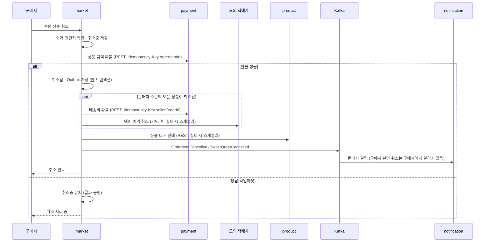
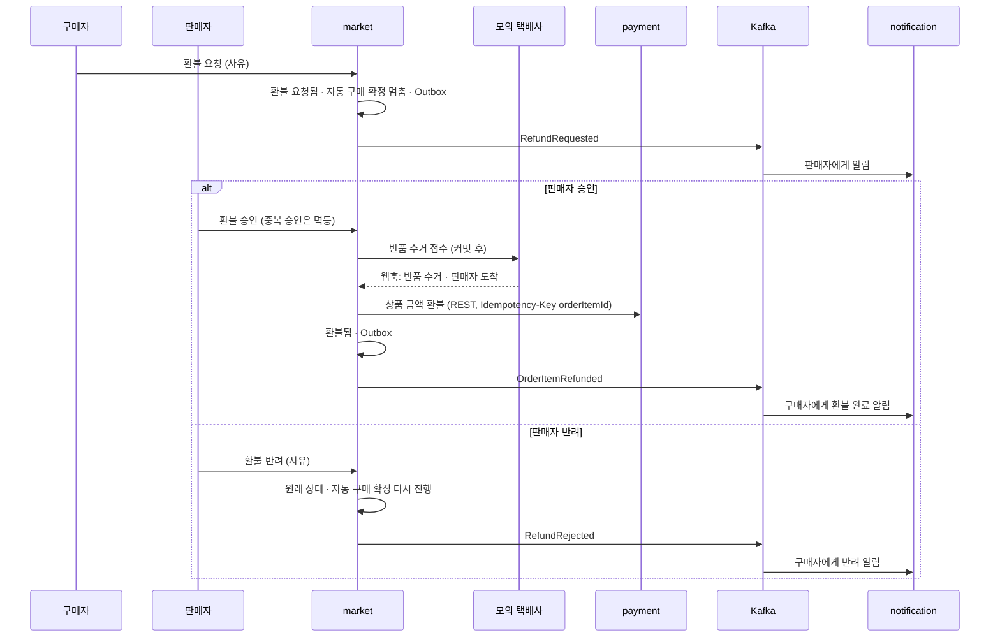

# 취소 · 환불

> 언제 읽나: 주문 취소, 반품 환불 코드를 고칠 때
> 상태: ✅ 확정 · 마지막 수정 2026-11-04 · 관련: 노션 기획안 「주문 취소 → 환불」 「반품 → 환불」

## 수거 전 취소

배송이 `READY` · `BOOKED`일 때만 취소할 수 있습니다 (`PICKED_UP` 이후에는 반품 환불).

## 반품 환불

택배 수거 이후 ~ 구매 확정 전. 환불된 상품은 **다시 판매하지 않고 판매 종료**합니다.

## 실패와 재시도

| 실패 | 처리 |
|---|---|
| 환불 응답 타임아웃 | 취소중 유지 → 스케줄러가 같은 멱등 키로 다시 요청해 확정 |
| 택배 예약 취소 실패 | 5분 스케줄러가 재시도 (S-E05) |
| 상품 다시 판매 실패 | 스케줄러가 재시도, 주문 취소는 그대로 완료 |
| 같은 취소 두 번 | 환불 1번 · 택배 취소 1번 (S-E04) |
