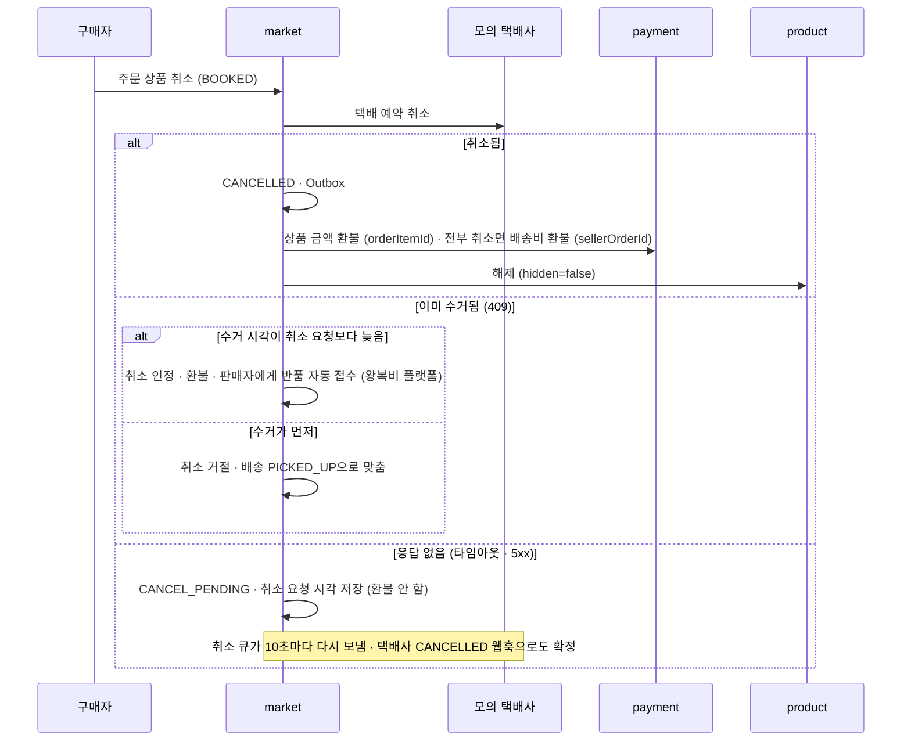

# 취소 · 환불

> 언제 읽나: 주문 취소, 반품 환불 코드를 고칠 때
> 상태: ✅ 확정 · 마지막 수정 2026-11-06 · 관련: 노션 기획안 「주문 취소 → 환불」 「반품 → 환불」

## 수거 전 취소

| 배송 상태 | 처리 |
|---|---|
| 배송 없음 (`ACCEPT_PENDING`) | 택배사 호출 없이 바로 취소 · 환불 |
| `READY` | 행을 잠그고 바로 `CANCELLED` · 환불 |
| `BOOKED` (화면 "픽업 대기") | **택배사 취소 API를 먼저 호출**하고 응답으로 판단 (아래) |
| `PICKED_UP` 이후 | 취소 불가 → 배송 완료 후 반품 |

상품 하나만 취소하면 그 상품 금액만 환불하고 배송은 유지합니다. 구매자 본인 취소는 구매자에게 알리지 않고, 상품은 숨기지 않습니다.

## 반품 환불

| 단계 | 규칙 |
|---|---|
| 신청 | 배송 완료 후 72시간 안, 주문상품 하나씩. **판매자 귀책만** (상품 파손 · 설명과 다름 · 기타). 구매 확정된 상품은 불가. 신청하면 자동 구매 확정에서 빠짐 |
| 판매자 응답 | 48시간 안에 승인 · 거절. 무응답이면 **자동 승인** |
| 거절 | 반품을 진행하지 않고 그 주문상품을 **바로 구매 확정** |
| 반품 배송 | 새 배송 행(방향 = 반품), 보내는 사람 구매자 · 받는 사람 판매자. 반품 배송비는 판매자 부담 |
| 도착 | 판매자에게 배송 완료되면 반품 완료 (판매자 검수 없음) |
| 환불 | `HOLDING` → 구매자 지갑. 결제 때 쓴 잔액대로 충전금부터 돌려주고 넘는 금액은 정산금으로. 판매자 주문의 상품이 **모두** 반품되면 배송비도 환불 |
| 상품 | `ACTIVE` + 숨김 (`hidden=true`) |
| 판매자 부담금 | 반품 배송비 (전부 반품이면 원래 배송비 포함). 정산을 만들 때 정산금에서 차감 → [구매 확정 → 정산](confirm-settlement.md) |

## 실패와 재시도

| 실패 | 처리 |
|---|---|
| 환불 응답 타임아웃 | 결과 불명 → 스케줄러가 같은 멱등 키로 확인 |
| 택배 취소 응답 없음 | `CANCEL_PENDING` → 취소 큐 10초, 포기 없음 |
| 상품 해제 실패 | 스케줄러가 끝까지 재시도, 취소 · 환불은 그대로 완료 |
| 같은 취소 두 번 | 환불 1번 · 택배 취소 1번 |
