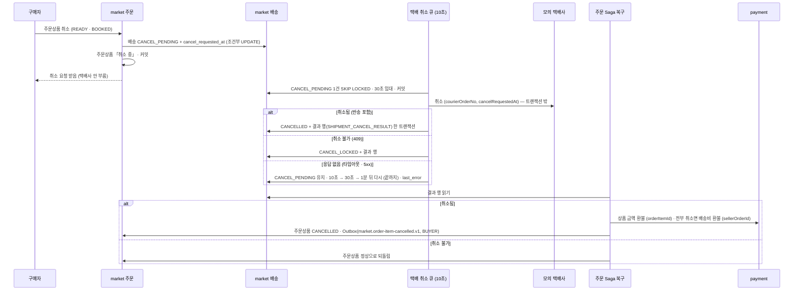

# 취소 · 환불

> 언제 읽나: 주문 취소, 반품 환불 코드를 고칠 때
> 상태: ✅ 확정 · 마지막 수정 2026-11-20 · 관련: 노션 기획안 「주문 취소 → 환불」 「반품 → 환불」, 노션 「정책 정리」 3.11 · 4.5 · 7 · 8.4 · 11.3 · 11.5

## 수거 전 취소

취소 API는 배송에 「취소 대기」만 기록하고 끝납니다. 택배사 취소는 택배 취소 큐가 보내고, 택배사가 구매자가 누른 시각의 기사 거리로 판정합니다 → [ADR 0026](../decisions/0026-courier-cancel-queue-and-distance-judgment.md)

| 배송 상태 | 처리 |
|---|---|
| 배송 없음 (`ACCEPT_PENDING`) | 택배사 호출 없이 바로 취소 · 환불 |
| `READY` · `BOOKED` | 조건부 UPDATE로 `CANCEL_PENDING` + 누른 시각(`cancel_requested_at`) 기록 → 커밋. 택배사는 부르지 않음. 같은 취소 두 번이면 한 번만 통과 |
| `CANCEL_LOCKED` (기사 2km 안) | 취소 불가. market이 바로 거절하고 택배사를 부르지 않음 |
| `PICKED_UP` 이후 | 취소 불가 → 배송 완료 후 반품 |

택배사 판정 (누른 시각 기준):

| 누른 시각의 기사 | 결과 | 비용 |
|---|---|---|
| 수거지 2km 밖 | 취소 | – |
| 2km 안 | 취소 불가 (409) → 배송 `CANCEL_LOCKED` | 없음 (배정 · 5km · 2km 알림과 주문 상세 문구로 미리 고지) |
| 2km 잠금 직후 30초 안 + 아직 수거 전 | 취소 (화면 갱신이 늦을 수 있어서) | – |
| 2km 밖이었는데 택배사 장애로 그사이 수거됨 | 취소 + **택배사 반송** (`RETURNING` → `RETURNED`). market은 새 배송 행을 만들지 않고, 판매 재개는 반송 완료 뒤 | 택배사 |
| 택배사에 예약이 없음 (예약 전 취소) | 택배사가 「취소됨」을 기록하고, 늦게 온 같은 주문번호 예약을 받지 않음 | – |

상품 하나만 취소해 판매자 주문에 다른 상품이 남으면 배송을 유지하므로 택배 결과를 기다리지 않습니다. 주문상품을 「취소 중」으로 커밋한 뒤 트랜잭션 밖에서 그 상품 금액만 바로 환불합니다. 판매자 주문의 마지막 상품을 취소하면 전부 취소와 같이 택배 결과를 기다립니다. 주문 전체를 취소해도 판매 재개 이벤트는 주문상품마다 발행합니다. 상품은 환불이 성공한 뒤에 되돌립니다 (먼저 되돌리면 환불 실패 때 같은 상품이 다른 사람에게 팔릴 수 있음). 구매자 본인 취소는 구매자에게 알리지 않고, 상품은 숨기지 않습니다.

## 반품 환불

| 단계 | 규칙 |
|---|---|
| 신청 | 배송 완료 후 72시간 안, 주문상품 하나씩. **판매자 귀책만** (상품 파손 · 설명과 다름 · 기타). 구매 확정된 상품은 불가. 신청하면 자동 구매 확정에서 빠짐 |
| 판매자 응답 | 48시간 안에 승인, 거절 (`orders/items/{id}/return/approve`, `reject`). 무응답이면 **자동 승인** (10분 주기). 승인, 거절, 자동 승인은 주문 → 판매자 주문을 잠그고 반품 신청 상태를 다시 보므로 먼저 잠근 쪽만 반영되고, 늦은 승인, 거절은 409 `RETURN_NOT_DECIDABLE`, 늦은 자동 승인은 건너뜀 |
| 거절 | 반품을 진행하지 않고 그 주문상품을 **바로 구매 확정**. 판매자 주문의 마지막 미완료 상품이면 판매자 주문 종료 판정이 정산 이벤트를 보냄 |
| 반품 배송 | 승인 때 그 주문상품만 담은 새 배송 행(방향 = 반품, `READY`)을 만들고 반품 신청에 연결. 택배 예약은 예약 큐가 함. 보내는 사람 구매자(주문 배송지), 받는 사람 판매자(기본 배송지). 반품 배송비(배송비와 같은 값)는 승인 때 `return_shipping_fee`로 남기고 판매자 부담. 반품 배송은 `ShipmentStatusChanged`를 발행하지 않고, 반품 알림은 `ReturnApproved`, `ReturnRejected` 등 반품 이벤트로 보냄 |
| 도착 | 판매자에게 배송 완료되면 반품 완료 (판매자 검수 없음) |
| 환불 | `HOLDING` → 구매자 지갑. 판매자 주문의 상품이 **모두** 반품되면 배송비도 환불 |
| 상품 | 환불 뒤 `market.order-item-returned.v1` → `ACTIVE` + 숨김 |
| 판매자 부담금 | 반품 완료된 반품 배송비 합. 전부 반품(취소되지 않은 상품이 모두 반품)이면 원래 배송비도 더함. 판매자 주문이 끝날 때 구매 확정 상품이 있으면 `PurchaseConfirmed`, 없으면 `SellerOrderReturned`의 `sellerBurdenAmount`로 보내고, 정산을 만들 때 정산금에서 차감 → [구매 확정 → 정산](confirm-settlement.md) |

## 실패와 재시도

| 실패 | 처리 |
|---|---|
| 환불 응답 타임아웃, 5xx, 연결 실패 | 결과 불명 → 주문상품을 「취소 중」으로 두고 `last_error` 기록. Saga 복구가 마지막 시도에서 10초 지나면 같은 키(orderItemId, sellerOrderId)로 다시 요청 (판매자 주문 전부 취소면 배송비도). payment는 같은 키면 `ALREADY_REFUNDED`로 처음 결과. 상품 금액과 배송비 환불이 모두 확정된 뒤 취소 완료와 판매 재개 이벤트. 복구 5번 안 되면 주문상품 `REVIEW_REQUIRED` |
| 환불 확정 실패 (4xx) | 다시 요청하지 않고 주문상품 `REVIEW_REQUIRED`, `last_error`, ERROR 로그. 배송비 환불이 실패하면 배송비를 함께 요청한 주문상품 모두가 `REVIEW_REQUIRED`가 되고 `last_error`는 `SHIPPING_FEE_`로 시작 (예: `SHIPPING_FEE_HTTP_400_INVALID_AMOUNT`) |
| 택배 취소 응답 없음 | `CANCEL_PENDING` → 택배 취소 큐가 포기 없이 다시 보냄 (주기 → [스케줄러 표](../reference/schedulers.md)) |
| 판매 재개 이벤트 | Outbox 재전송 · 소비 재시도 · DLT. 취소 · 환불은 그대로 완료 |
| 같은 취소 두 번, 복구가 겹침 | 환불 반영 1번, 택배 취소 1번, 판매 재개 이벤트 1번 (결과 반영은 「취소 중」일 때만) |
