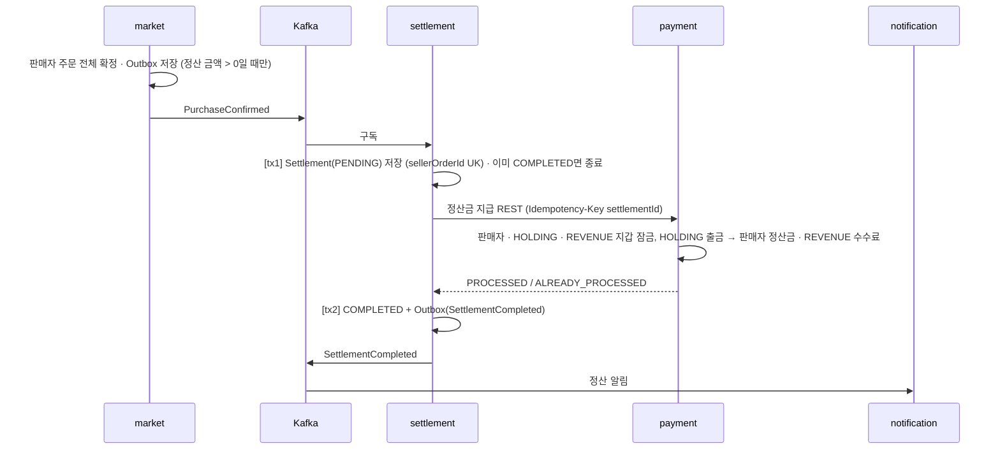

# 구매 확정 → 정산

> 언제 읽나: 구매 확정 · 정산 · 정산금 지급 코드를 고칠 때
> 상태: ✅ 확정 · 마지막 수정 2026-11-04 · 관련: 노션 기획안 「구매 확정 → 정산 시퀀스」

## 시퀀스

수수료 5% (판매액에만, 배송비 제외, 원 단위 미만 버림) → [settlement 정책](../services/settlement.md#정책)

## 배송비 매출

`ShipmentPickedUp`(Outbox) → **payment가 직접 구독**해 배송비를 매출 지갑으로 옮깁니다. 세미에서는 settlement 리스너가 했지만, MSA에서는 settlement를 거칠 이유가 없어 바꿨습니다. 멱등은 거래 내역 UK(sellerOrderId)입니다.

## 자동 구매 확정

| 항목 | 값 |
|---|---|
| 기준 | 배송 완료 후 72시간 |
| 주기 | 1시간 (market 스케줄러) |
| 건너뜀 | 환불 요청 중인 상품 |
| 이벤트 | `OrderItemAutoConfirmed` → settlement · notification |
