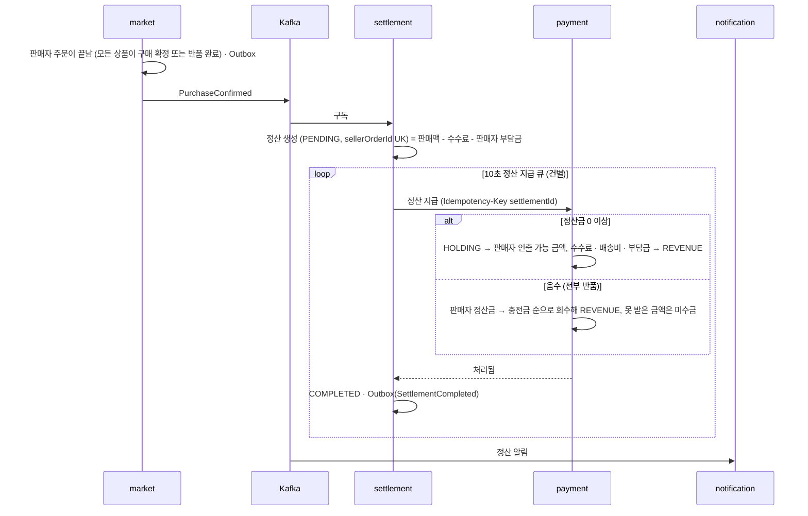

# 구매 확정 → 정산

> 언제 읽나: 구매 확정 · 정산 · 정산금 지급 코드를 고칠 때
> 상태: ✅ 확정 · 마지막 수정 2026-11-06 · 관련: 노션 기획안 「구매 확정 → 정산 시퀀스」

## 시퀀스

| 규칙 | 내용 |
|---|---|
| 정산 상태 | `PENDING` · `COMPLETED` · `FAILED` (`HOLD` 없음). 실패하면 다음 회차에 다시 (포기 없음) |
| 안 만드는 경우 | 모든 상품이 수거 전에 취소됨 |
| 음수 정산 | 모든 상품이 반품되면 판매자 부담금만큼 음수 정산 |
| 미수금 | 판매자 지갑에 기록. 이후 정산금 · 충전 · 환불로 돈이 들어오면 먼저 차감해 REVENUE로. 미수금이 있으면 인출 · 탈퇴 불가 |
| 반품 진행 중 | 판매자 주문이 끝나지 않아 정산을 만들지 않음 |
| 수수료 | 5%, 판매액에만 (배송비 제외), 원 단위 미만 버림 |

## 배송비 매출

판매자 주문의 모든 상품이 구매 확정된 뒤 **정산을 지급할 때** 배송비를 `HOLDING` → `REVENUE`로 옮깁니다 (환불 로직 때문). 배송비가 이미 환불된 판매자 주문(수거 전 전량 취소, 수거 후 전부 반품)은 건너뜁니다. 같은 판매자 주문의 배송비는 한 번만 처리합니다.

## 자동 구매 확정

| 항목 | 값 |
|---|---|
| 기준 | 배송 완료 후 72시간, `NORMAL` 상품 |
| 주기 | 1시간 (market 스케줄러, SKIP LOCKED) |
| 제외 | 반품 신청한 상품 |
| 반품 거절 | 그 상품을 바로 구매 확정 |
| 이벤트 | `OrderItemAutoConfirmed` → settlement · notification |
