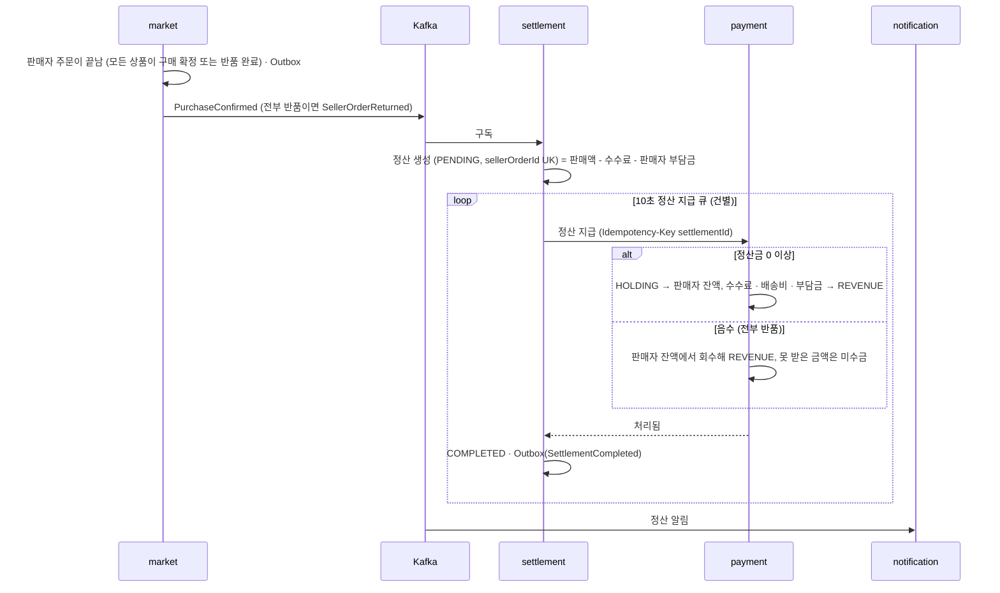

# 구매 확정 → 정산

> 언제 읽나: 구매 확정 · 정산 · 정산금 지급 코드를 고칠 때
> 상태: ✅ 확정 · 마지막 수정 2026-11-25 · 관련: 노션 기획안 「구매 확정 → 정산 시퀀스」

## 시퀀스

| 규칙 | 내용 |
|---|---|
| 정산 상태 | `PENDING` · `COMPLETED` · `FAILED` (`HOLD` 없음). 실패하면 다음 회차에 다시 (포기 없음) |
| 안 만드는 경우 | 모든 상품이 수거 전에 취소됨 |
| 음수 정산 | 모든 상품이 반품되면(전부 반품, `SellerOrderReturned`) 판매액 0, 정산금 = −판매자 부담금인 정산 (부담금 0이면 정산금 0). settlement 수신 ✅ #432 |
| 미수금 | 판매자 지갑에 기록. 이후 정산금 · 충전 · 환불로 돈이 들어오면 먼저 차감해 REVENUE로. 미수금이 있으면 인출 · 탈퇴 불가 |
| 반품 진행 중 | 판매자 주문이 끝나지 않아 정산을 만들지 않음 |
| 수수료 | 5%, 판매액에만 (배송비 제외), 원 단위 미만 버림 |

## 배송비 매출

판매자 주문의 모든 상품이 구매 확정된 뒤 **정산을 지급할 때** 배송비를 `HOLDING` → `REVENUE`로 옮깁니다 (환불 로직 때문). 배송비가 이미 환불된 판매자 주문(수거 전 전량 취소, 수거 후 전부 반품)은 건너뜁니다. 같은 판매자 주문의 배송비는 한 번만 처리합니다 (`sellerOrderId` 기준, 이미 옮긴 배송비도 건너뜀). 배송비를 건너뛰어도 정산 지급은 계속합니다.

## 자동 구매 확정

| 항목 | 값 |
|---|---|
| 기준 | 배송 완료 후 72시간, `NORMAL` 상품 |
| 주기 | 1시간 (market 스케줄러, SKIP LOCKED) |
| 제외 | 반품 신청한 상품 |
| 반품 거절 | 그 상품을 바로 구매 확정 |
| 이벤트 | `OrderItemAutoConfirmed` → settlement · notification |

## 정산 대사

settlement의 정산과 payment의 정산 원장을 매일 비교해 어긋난 곳을 기록합니다. 데이터를 고치지 않고 찾기만 합니다. 실행 시각과 설정은 [스케줄러](../reference/schedulers.md), 알림은 [관측](../infra/observability.md#알림-규칙)에 있습니다.

| 항목 | 내용 |
|---|---|
| 대상 | `PENDING`, `FAILED` 정산 전부, `completed_at`이 최근 7일 안인 `COMPLETED` 정산 |
| 비교 원장 | payment `POST /internal/v1/settlementPayouts/ledgers`로 읽은 정산 원장. 100개씩 트랜잭션 밖에서 부르고, 조회가 실패하거나 응답 키가 요청과 다르면 그 배치는 건너뜀 |
| 기록 | `settlement_reconciliation_mismatch`. 미해결 행에만 유니크 (`settlement_id`, `mismatch_type`)라 같은 불일치는 한 행, 해결한 뒤 다시 생기면 새 행 |
| 실행 이력 | `settlement_reconciliation_run`. `SUCCEEDED`: 실패한 배치 없음 (대상 0건 포함), `PARTIAL`: 일부 배치 실패, `FAILED`: 모든 배치 실패 또는 대상 조회, 기록 중 예외 |
| 기준 행 | V7 마이그레이션이 배포 시각으로 `BASELINE` 행 1개를 넣음. 실행 결과가 아니므로 실행 횟수 지표(`settlement_reconciliation_runs_total`)와 실행 통계에서 뺌 (실행 이력을 셀 때는 `result <> 'BASELINE'`). 성공 이력이 없을 때 미실행 알림의 기준 시각으로만 씀 |

기대 원장 (정산금 p, 수수료 f, 판매자 부담금 b, 회수액 c):

| 지갑 | 참조 유형 | 방향 | 금액 | 없을 때 |
|---|---|---|---|---|
| `HOLDING` | `SETTLEMENT` | `OUT` | p + f + b | 0이면 없음 |
| `REVENUE` | `SETTLEMENT_FEE` | `IN` | f | 0이면 없음 |
| 판매자 지갑 | `SETTLEMENT` | `IN` | p > 0이면 p, 아니면 0 | 항상 1건 (지급 여부의 기준 행) |
| 판매자 지갑 | `SETTLEMENT_COLLECTION` | `OUT` | c (0 < c ≤ \|p\|) | 음수 정산이 아니거나 c = 0이면 없음 |
| `REVENUE` | `SELLER_BURDEN` | `IN` | p ≥ 0이면 b, 음수 정산이면 b − \|p\| + c | 0이면 없음 |

판정:

| 유형 | 조건 |
|---|---|
| `UNEXPECTED_WALLET` | 판매자 지갑, `HOLDING`, `REVENUE`가 아닌 지갑에 정산 원장이 있음. 기록에는 walletId만 남기고 memberId는 남기지 않음 |
| `MISSING_LEDGER` | `COMPLETED`인데 판매자 `SETTLEMENT` `IN`이 없음. 금액은 비교하지 않음 |
| `AMOUNT_MISMATCH` | 판매자 `SETTLEMENT` `IN`이 있으면 정산 상태와 상관없이 위 표와 지갑, 참조 유형, 방향, 금액, 건수를 비교해 다름. 또는 `PENDING`, `FAILED`인데 판매자 행 없이 다른 정산 원장만 있음 (payment는 한 트랜잭션으로 쓰므로 시간이 지나도 채워지지 않음) |
| `UNREFLECTED_STATUS` | `PENDING`, `FAILED`인데 판매자 `SETTLEMENT` `IN`의 지급 시각(`ref_occurred_time`)에서 10분 이상 지남. 기록 직전에 정산을 `FOR SHARE`로 다시 읽어 그사이 `COMPLETED`가 됐으면 기록하지 않음 |

대사 범위의 한계:

| 한계 | 내용 |
|---|---|
| 음수 정산의 회수액 | 회수액 c는 지급 시점의 판매자 잔액으로 payment가 정하고, settlement는 그 잔액을 모름. 0 < c ≤ \|p\|와 `SELLER_BURDEN` `IN` = b − \|p\| + c만 확인하므로, 범위 안의 잘못된 c도 부담금 `IN`이 그에 맞게 기록되면 통과 |
| 범위 밖 원장 | 배송비(`SHIPPING_FEE`, `ref_id` = 판매자 주문 ID), 미수금 차감(`RECEIVABLE_COLLECTION`), 미수금 금액, 지갑 잔액은 보지 않음 |
| 오래된 정산 | 완료된 지 7일 넘은 `COMPLETED` 정산은 다시 보지 않음 |
| 판매자 주문과 정산 | 끝난 판매자 주문에 정산이 만들어졌는지는 보지 않음 (⬜ 미정) |

해결 처리 (운영자, SQL):

| 순서 | 할 일 |
|---|---|
| 1 | 미해결 불일치 확인: `select * from settlement_reconciliation_mismatch where resolved_at is null order by detected_at;` |
| 2 | `expected`, `actual`과 settlement ERROR 로그로 원인을 찾아 고침 |
| 3 | 해결 기록: `update settlement_reconciliation_mismatch set resolved_at = now() where id = :id;` |
| 4 | 같은 불일치가 다시 생기면 다음 대사가 새 행으로 기록하고 다시 알림 |
