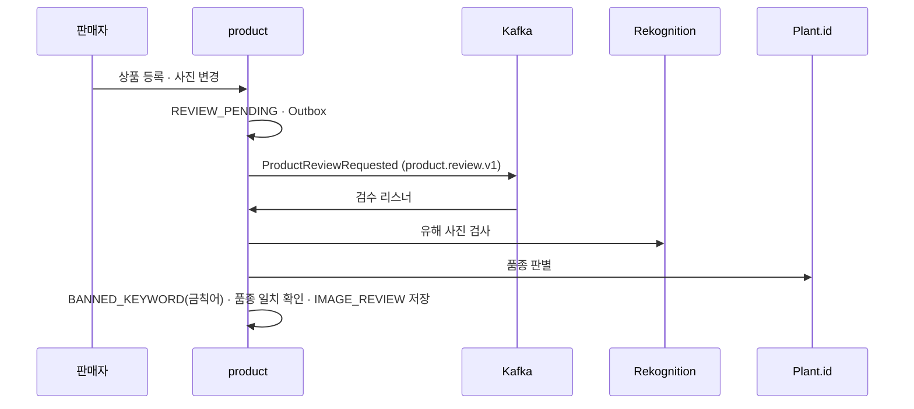

# 사진 검수

> 언제 읽나: 상품 사진 검수 코드를 고칠 때
> 상태: 🟨 제안 · 마지막 수정 2026-11-04 · 관련: Miro 13-1

## 흐름

외부 호출 값 → [장애 처리 값](../conventions/resilience.md)

## 결과별 처리

| 결과 | 상품 상태 | 이벤트 | 다음 |
|---|---|---|---|
| 통과 | `ACTIVE` | `ProductApproved` | 검색 색인 · ai 추천 후보 |
| 거절 (유해 사진 · 금칙어 · 판매 금지 품종) | `REJECTED` | `ProductRejected` | 판매자 알림 |
| 애매함 · 외부 API 계속 실패 | `REVIEW_PENDING` 유지 (`MANUAL`) | – | 관리자 수동 검수 |

## 관리자 수동 검수

`GET /api/v1/admin/imageReviews?status=MANUAL`로 대기 목록을 보고, `PATCH /api/v1/admin/imageReviews/{id}`로 통과 · 거절을 정합니다 (ADMIN). 결과는 자동 검수와 같은 이벤트를 냅니다.

## 외부 서비스 설정

| 항목 | 내용 | 상태 |
|---|---|---|
| Rekognition | AWS 허용 목록 밖 → aws 채널에 근거와 함께 사용 승인 요청 | ⬜ |
| 권한 | EC2 역할에 Rekognition · S3 읽기 권한, 컨테이너에서 쓰려면 IMDSv2 hop limit 2 | ⬜ |
| Plant.id | `PLANT_ID_API_KEY` (product) | ✅ |
