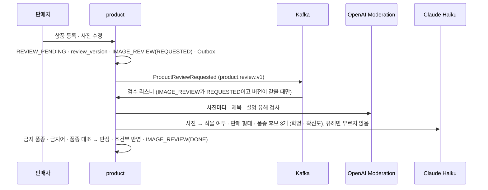

# 사진 검수

> 언제 읽나: 상품 사진 검수 코드를 고칠 때
> 상태: ✅ 확정 · 마지막 수정 2026-11-14 · 관련: Miro 13-1, 노션 「정책 정리」 3.3 · 3.4 · 3.16

## 흐름

등록과 따로 **비동기**로 검수합니다 → [ADR 0012](../decisions/0012-review-moderation-haiku.md)

| 단계 | 내용 |
|---|---|
| 유해 검사 | OpenAI Moderation(`omni-moderation-latest`), `flagged`면 반려하고 끝 |
| 식물 식별 | Claude Haiku(`claude-haiku-5-5`), 프롬프트에 금지 품종 목록 포함 |
| 금지 품종 대조 | 후보 학명을 `banned_species` 학명 · 학명 별칭과 비교 (속 · 종 · 변종 단위) |
| 금지어 대조 | 제목 · 설명을 정규화(띄어쓰기 · 문장부호 제거)해 `banned_species` 한글 이름 · 별칭과 `banned_keyword`를 찾음. 예외 단어(`EXCEPTION`)는 넘어가고, 관리자 확인 단어(`REVIEW`, 예: 자생지)는 반려 대신 관리자 확인 |
| 품종 대조 | 1순위 후보의 학명 속, 또는 후보 한글 이름으로 `species.name` · `species_alias`에서 찾은 품종의 `scientific_name` 속이 판매자가 고른 품종과 **속까지** 같으면 일치 |

판매 중(`ACTIVE`) 상품의 글만 수정하면 사진 검수는 다시 하지 않고 글 Moderation과 금지어 대조만 합니다. 걸리면 `REJECTED`, 관리자 확인이면 판매를 멈추고 `REVIEW_PENDING`입니다. 검수 중 · 반려 상품은 글만 고쳐도 처음부터 검수합니다 (반려 사유가 사진일 수 있음).

## 결과별 처리

위에서부터 처음 해당하는 줄에서 정해집니다. 기준값 0.3 · 0.7은 3차 실험 결과이고, 11/13 실제 Haiku 5.5로 3차 실험 사진 146건, 11/14 실판매 사진(심폴) 631건을 다시 측정해 유지했습니다. 2 · 3순위 금지 후보는 0.1 이상이면 의심합니다 (11/13 위장 등록이 0.10~0.25로만 들어오고, 11/14 호접란 사진에 나도풍란이 0.03~0.08로 습관처럼 붙음). 품종 대조에서 옛 속 이름 Sansevieria는 Dracaena와 같은 속으로 봅니다.

| 상황 | 결과 |
|---|---|
| 사진이 유해 | 반려 `HARMFUL_IMAGE` |
| 제목 · 설명이 유해 | 반려 `INAPPROPRIATE_TEXT` |
| 식물이 아님 | 반려 `NOT_PLANT` |
| 씨앗 · 삽수 · 구근 | 반려 `PROHIBITED_FORM` |
| 1순위가 금지 품종, 확신도 0.7 이상 | 반려 `BANNED_SPECIES` |
| 제목 · 설명에 금지어 | 반려 `BANNED_SPECIES` |
| 1순위 금지 품종인데 0.7 미만, 2 · 3순위가 금지(확신도 0.1 이상), 변종 금지에 종까지만 일치, 제목 · 설명에 관리자 확인 단어 | 관리자 확인 |
| 판매자가 "기타" 품종 선택 | 관리자 확인 |
| 후보 없음 또는 1순위 0.3 미만 | 관리자 확인 |
| 품종 일치 | 통과 → `ACTIVE` · `ProductApproved` · `ProductStatusChanged` |
| 품종 불일치 | 관리자 확인 |
| 외부 API 오류 (재시도 후에도) · 응답 해석 불가 | 엔진 오류 재처리 (5분 간격 최대 3회), 그래도 실패하면 관리자 확인 → [엔진 오류 재처리](#엔진-오류-재처리) |

- 결과는 "검수 버전이 같고 사진 검수는 `REVIEW_PENDING`, 글 검사는 `ACTIVE`일 때만" 조건을 건 UPDATE로 반영합니다. 0건이면(그사이 수정 · 삭제 · 예약) 반영하지 않고 `IMAGE_REVIEW`를 `STALE`로 둡니다. 외부 API 장애로 자동 통과도 자동 반려도 하지 않습니다 (재시도: Moderation 3번, Haiku SDK 재시도 2번).
- 통과 · 반려(글 검사 반려 포함)로 상태가 바뀌면 새 상태가 담긴 `ProductStatusChanged`도 발행합니다 (ai 상품 스냅샷 → [ADR 0021](../decisions/0021-product-event-payload-ai-snapshot.md)). `ProductApproved`(통과 알림) · `ProductRejected`(반려 알림)는 notification용입니다.
- 반려되면 `ProductRejected` → 판매자에게 사유와 함께 알립니다. 재검수(수정 후 다시 제출)는 1회까지입니다.
- 자동 반려가 틀렸다면 판매자는 수정하지 않고 **이의 신청**을 합니다 (메모 필수 200자, 같은 검수 버전으로 1번, 관리자가 반려하면 최종, 재검수 횟수를 쓰지 않음. 관리자가 반려한 상품은 409 `APPEAL_NOT_ALLOWED`, 두 번째는 409 `APPEAL_ALREADY_USED`. 이의 신청 중에 수정하면 이의 신청은 끝나고 엔진 검수로 가며 재검수 1회를 씀).

## 엔진 오류 재처리

외부 API(Moderation · Haiku)가 재시도 후에도 실패하거나 응답을 해석하지 못하면, 바로 관리자에게 넘기지 않고 엔진으로 다시 검수합니다 (11/11 결정).

| 주제 | 규칙 |
|---|---|
| 상태 | 사진 검수: 상품은 `REVIEW_PENDING` 그대로. 판매 중 상품의 글 검사(`TEXT_ONLY`): 상품은 `ACTIVE` 그대로, 재처리 동안 판매 유지 (🟨 팀 확인 중). 둘 다 `IMAGE_REVIEW`는 `ENGINE_ERROR` |
| 재처리 | 스케줄러가 5분마다 `ENGINE_ERROR` 건을 같은 검수 버전으로 다시 검수, 최대 3회. 그사이 수정 · 삭제되면(버전이 다르면) 재처리하지 않음 |
| 3회 모두 실패 | 관리자 확인으로 넘김 (사유 `ENGINE_ERROR`). 자동 통과 · 자동 반려는 하지 않음 |
| 횟수 · 제한 | 재처리는 하루 사진 검수 30회 · 재검수 1회에 세지 않음 (판매자 잘못이 아님) |
| 기한 | 12 · 24시간 기한은 관리자 확인으로 넘어간 시점부터 셈. 재처리하는 동안은 세지 않음 |
| 판매자 화면 | "검수 중" 그대로, 문구 "확인에 시간이 조금 더 걸리고 있어요" |
| 관리자 화면 | 관리자 확인 목록에서 사유 `ENGINE_ERROR`로 구분. 엔진에 다시 맡기는 수동 「다시 검수」 버튼은 두지 않음 (관리자가 사진을 보고 직접 통과 · 반려) |

## 관리자 수동 검수

관리자 확인 목록은 오래된 순으로 봅니다. 관리자는 사진 · 엔진 결과(후보 · 확신도 · 판매 형태 · 금지 의심 사유) · 판매자 품종 · 이의 신청 메모를 보고 통과나 반려를 고릅니다. 판매자가 고른 품종은 고치지 않습니다.

| 반려 사유 코드 | 판매자 문구 | 자동 반려 |
|---|---|---|
| `NOT_PLANT` | 식물 사진이 아니에요 | ✅ |
| `HARMFUL_IMAGE` | 부적절한 사진이 포함돼 있어요 | ✅ |
| `BANNED_SPECIES` | 판매 금지 품종이에요 | ✅ |
| `PROHIBITED_FORM` | 씨앗 · 삽수 · 구근은 팔 수 없어요 | ✅ |
| `REVIEW_EXPIRED` | 확인이 늦어져 반려됐어요. 다시 등록할 수 있어요 | ✅ (24시간 초과) |
| `SPECIES_MISMATCH` | 선택한 품종과 사진 속 식물이 달라요 |  |
| `UNCLEAR_IMAGE` | 사진으로 상품을 확인하기 어려워요 |  |
| `INAPPROPRIATE_TEXT` | 제목이나 설명에 부적절한 내용이 있어요 | ✅ |
| `OTHER` | 관리자가 입력한 내용 (필수, 200자) |  |

- 두 관리자가 동시에 처리하거나 그사이 판매자가 수정 · 삭제하면 늦은 쪽은 409입니다.
- 처리자 · 결과 · 사유 · 시각을 `IMAGE_REVIEW`에 남깁니다.
- **기한**: 관리자 확인으로 간 지 12시간이 지나면 관리자에게 대기 건수를 묶어 알리고 판매자 화면에 "확인에 시간이 걸리고 있어요"를 보여줍니다. 그 뒤 12시간(모두 24시간)이 지나면 `REVIEW_EXPIRED`로 자동 반려합니다 (자동 승인 없음). `REVIEW_EXPIRED`는 판매자 잘못이 아니라 재검수 · 등록 제한에 세지 않고 같은 내용을 다시 제출할 수 있으며, 이의 신청 건이 `REVIEW_EXPIRED`로 끝나면 그 이의 신청도 횟수에 세지 않습니다. 주말에는 실제 처리 시간을 보고 조정합니다.

관리자 API: `GET /api/v1/admin/imageReviews?status=MANUAL`, `PATCH /api/v1/admin/imageReviews/{id}` (ADMIN)

## 판매자 API

| 메서드 | 경로 | 설명 |
|---|---|---|
| GET | `products/{id}/imageReviews` | 판매자 본인 검수 기록. 검수 버전별 표시 상태(검수 중 · 관리자 확인 중 · 확인 지연) · 결과 · 반려 사유와 문구 · 자동 / 관리자 판정 · 시각, 남은 재검수 횟수 · 이의 신청 가능 여부 |
| POST | `products/{id}/appeals` | 자동 반려 이의 신청 (`memo` 필수, 200자). 409 `APPEAL_NOT_ALLOWED` · `APPEAL_ALREADY_USED` |
| POST | `products/{id}/imageReviews` | 기한 초과(`REVIEW_EXPIRED`) 상품을 같은 내용으로 다시 검수 요청. 재검수 · 등록 제한에 세지 않음. 다른 상태면 409 `RESUBMIT_NOT_ALLOWED` |

모두 SELLER, 본인 상품만 (남의 상품은 404 `PRODUCT_NOT_FOUND`).

## 외부 서비스 설정

| 항목 | 내용 | 상태 |
|---|---|---|
| OpenAI Moderation | 사진 · 글 유해 검사 (API 키) | ✅ |
| Claude Haiku | 식물 식별 (API 키) | ✅ |
| 약관 | 사진 · 글이 Anthropic · OpenAI로 전송됨을 판매자 등록 때 개인정보처리방침에서 안내. 각 사 학습 사용 여부 확인 | ⬜ 담당 확인 |
| 비용 보호 | 판매자당 검수 중 5개 · 하루 등록 20건 · 하루 사진 검수 30회, 최근 7일 반려 5건 이상이면 자동 검수 없이 관리자 확인 → [product 정책](../services/product.md#정책) | ✅ |
