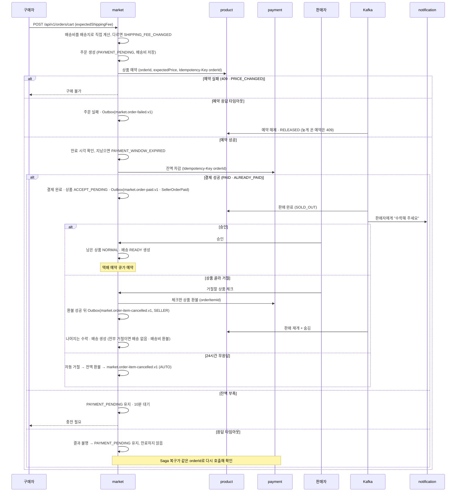

# 주문 · 결제 Saga

> 언제 읽나: 주문 · 결제 · 예약 · 판매 완료 코드를 고칠 때
> 상태: ✅ 확정 · 마지막 수정 2026-11-08 · 관련: Miro 13, 노션 기획안 「결제 시퀀스」, 노션 「정책 정리」 1.3 · 3.10 · 4.4 · 11

## 시퀀스

market이 지휘합니다 (오케스트레이션). 결과가 필요한 상품 예약 · 잔액 차감 · 환불은 REST, product의 판매 완료 · 예약 해제 · 판매 재개는 Outbox 이벤트입니다 → [ADR 0016](../decisions/0016-product-sale-events-from-market.md). 결제가 끝나면 **판매자가 수락해야 배송이 생깁니다** → [ADR 0013](../decisions/0013-shipment-after-seller-accept.md)

## 단계별 실패와 보상

| 단계 | 실패하면 | 보상 |
|---|---|---|
| 배송비 비교 | `SHIPPING_FEE_CHANGED` | 없음 (주문 안 만듦) |
| 상품 예약 — 409 · `PRICE_CHANGED` | 주문 실패 | 없음 (아무것도 예약 안 됨) |
| 상품 예약 — 응답 타임아웃 | 다시 호출하지 않고 주문 실패 | `market.order-failed.v1`로 예약 해제. 늦게 커밋된 예약도 `RELEASED`라 409 |
| 결제 — 기한 지남 | `PAYMENT_WINDOW_EXPIRED`, payment 호출 안 함 | 만료 스케줄러가 만료 · `market.order-expired.v1` |
| 잔액 차감 — 잔액 부족 | `PAYMENT_PENDING` 10분 대기 (배송비 안 바뀜) | 10분 뒤 만료 · `market.order-expired.v1` |
| 잔액 차감 — 응답 타임아웃 | 결과 불명, `PAYMENT_PENDING` 유지 · 만료 안 함 | Saga 복구가 같은 orderId로 다시 호출: `PAID` · `ALREADY_PAID`면 결제 완료, 잔액 부족이면 결제 대기 유지. 실패가 확실할 때만 예약 해제 |
| 판매 완료 이벤트 | 주문은 결제 완료 유지 | Outbox 재전송 · 소비 재시도 · DLT → [이벤트 규칙](../conventions/events.md) |
| 판매자 거절 · 자동 거절 | 체크한 상품 `CANCELLED` | 환불 → `market.order-item-cancelled.v1`(`SELLER` · `AUTO`), 알림은 거절 · 자동 취소 구분 |
| 택배 예약 | 배송 `READY` 유지 | 예약 큐가 포기 없이 재시도 |

결제 결과 조회 API는 두지 않습니다. 조회가 "없음"이어도 그 뒤 원래 요청이 늦게 처리되면 만료된 주문에서 돈이 빠지기 때문입니다 (노션 4.4). 수락 전에는 배송이 없어 구매자가 언제든 바로 취소 · 환불받습니다. 구매자 화면에서 `ACCEPT_PENDING`은 "판매자 확인 중"입니다. ⬜ 결제 흐름의 보상 목록 최종안은 성수 님이 정리 중입니다.

## 멈춘 주문 복구

| 항목 | 값 |
|---|---|
| 주기 | → [스케줄러 표](../reference/schedulers.md) |
| 대상 | 결과 불명 결제, 결과 불명 취소 · 환불 (주문상품 「취소 중」) |
| 방법 | 같은 멱등 키로 payment에 다시 요청. 결제는 실패가 확실할 때만 보상(예약 해제), 취소 · 환불은 되돌리는 동작이라 끝까지 진행 |
| 포기 | 5번 안 되면 `REVIEW_REQUIRED` |

⬜ 결제 중 주문 행 잠금 방식(잠금을 쥔 채 REST vs 「결제 중」 상태로 바꾼 뒤 REST)은 주문 · 결제 담당이 정하는 중입니다 → [미정](../open-questions.md)
