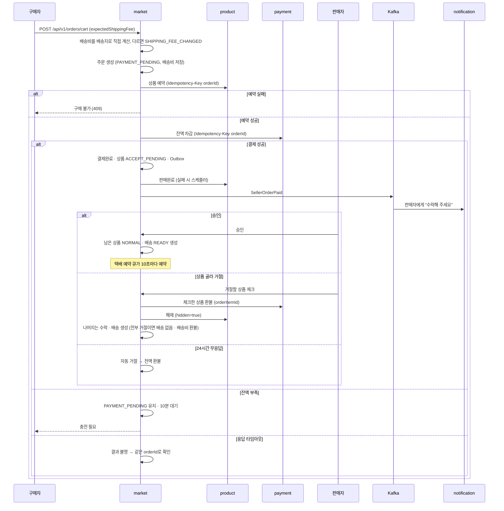

# 주문 · 결제 Saga

> 언제 읽나: 주문 · 결제 · 예약 · 판매완료 코드를 고칠 때
> 상태: ✅ 확정 · 마지막 수정 2026-11-06 · 관련: Miro 13, 노션 기획안 「결제 시퀀스」

## 시퀀스

market이 지휘합니다 (오케스트레이션, REST). 결제가 끝나면 **판매자가 수락해야 배송이 생깁니다** → [ADR 0013](../decisions/0013-shipment-after-seller-accept.md)

## 단계별 실패와 보상

| 단계 | 실패하면 | 보상 |
|---|---|---|
| 배송비 비교 | `SHIPPING_FEE_CHANGED` | 없음 (주문 안 만듦) |
| 상품 예약 | 주문 실패, 409 | 없음 |
| 잔액 차감 — 잔액 부족 | `PAYMENT_PENDING` 10분 대기 (배송비 안 바뀜) | 10분 뒤 예약 해제 |
| 잔액 차감 — 응답 타임아웃 | 결과 불명 | 실제 실패가 확인된 뒤에만 예약 해제 |
| 판매완료 | 주문은 결제완료 유지 | 스케줄러가 끝까지 재시도 |
| 판매자 거절 · 자동 거절 | 체크한 상품 `CANCELLED` | 환불 → 상품 해제(`hidden=true`), 알림은 거절 · 자동 취소 구분 |
| 택배 예약 | 배송 `READY` 유지 | 예약 큐가 포기 없이 재시도 |

수락 전에는 배송이 없어 구매자가 언제든 바로 취소 · 환불받습니다. 구매자 화면에서 `ACCEPT_PENDING`은 "판매자 확인 중"입니다. ⬜ 결제 흐름의 보상 목록 최종안은 성수 님이 정리 중입니다.

## 멈춘 주문 복구

| 항목 | 값 |
|---|---|
| 주기 | 1분 |
| 대상 | 멈춘 주문 (결과 불명 결제 등) |
| 방법 | 같은 멱등 키로 payment에 결과 조회 · 재요청 |
| 포기 | 5회 실패하면 `REVIEW_REQUIRED` |

⬜ 결제 중 주문 행 잠금 방식(잠금을 쥔 채 REST vs `PAYING` 상태)은 주문 · 결제 담당 회신 대기입니다 → [미정](../open-questions.md)
