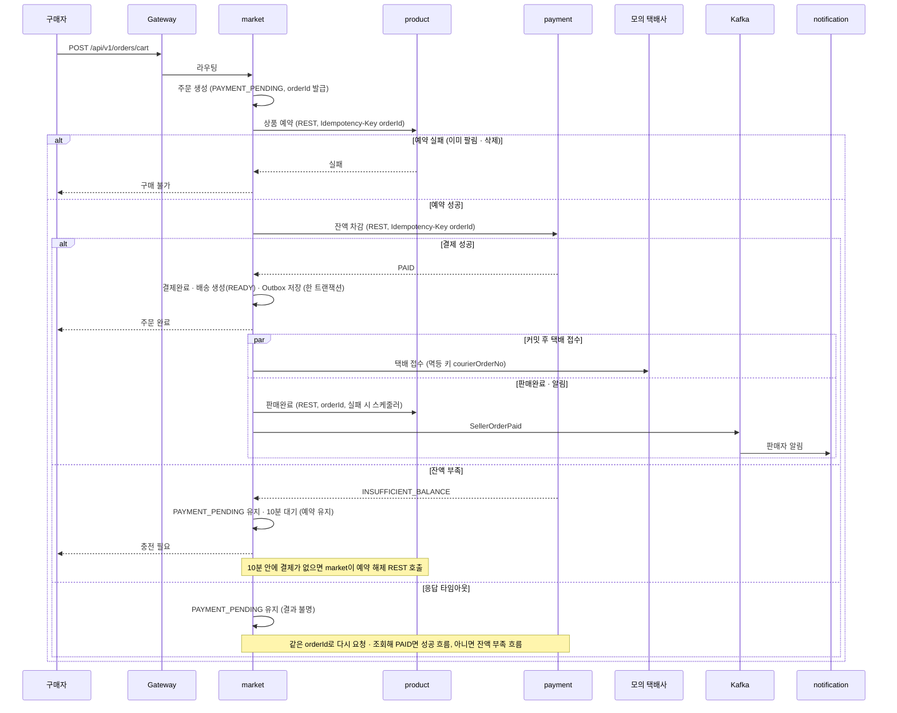

# 주문 · 결제 Saga

> 언제 읽나: 주문 · 결제 · 예약 · 판매완료 코드를 고칠 때
> 상태: ✅ 확정 · 마지막 수정 2026-11-04 · 관련: Miro 13, 노션 기획안 「결제 시퀀스」

## 시퀀스

market이 지휘합니다 (오케스트레이션, REST). 후속 알림은 이벤트입니다 → [ADR 0003](../decisions/0003-saga-market-orchestration.md)

## 단계별 실패와 보상

| 단계 | 실패하면 | 보상 |
|---|---|---|
| 상품 예약 | 주문 실패, 503 | 없음 (예약 안 됨) |
| 잔액 차감 — 잔액 부족 | `PAYMENT_PENDING` 10분 대기 | 10분 뒤 예약 해제 |
| 잔액 차감 — 응답 타임아웃 | 결과 불명, `PAYMENT_PENDING` 유지 | 실제 실패가 확인된 뒤에만 예약 해제 |
| 판매완료 | 주문은 결제완료 유지 | 보상 없음, 스케줄러가 같은 orderId로 재시도 |
| 택배 접수 | 배송 `READY` 유지 | 5분 스케줄러가 재접수 |

⬜ 결제 흐름의 보상 목록 최종안은 성수 님이 정리 중입니다. 값 → [장애 처리 값](../conventions/resilience.md)

## 멈춘 주문 복구

| 항목 | 값 |
|---|---|
| 주기 | 🟨 1분 |
| 대상 | 5분 넘게 `PAYMENT_PENDING` · 진행 중으로 멈춘 주문 |
| 방법 | 같은 멱등 키로 payment에 결과 조회 · 재요청 |
| 포기 | 5회 실패하면 `REVIEW_REQUIRED` (관리자 확인) |

결제 대기 10분 만료는 별도 스케줄러(30초)가 처리합니다 → [스케줄러](../reference/schedulers.md)
