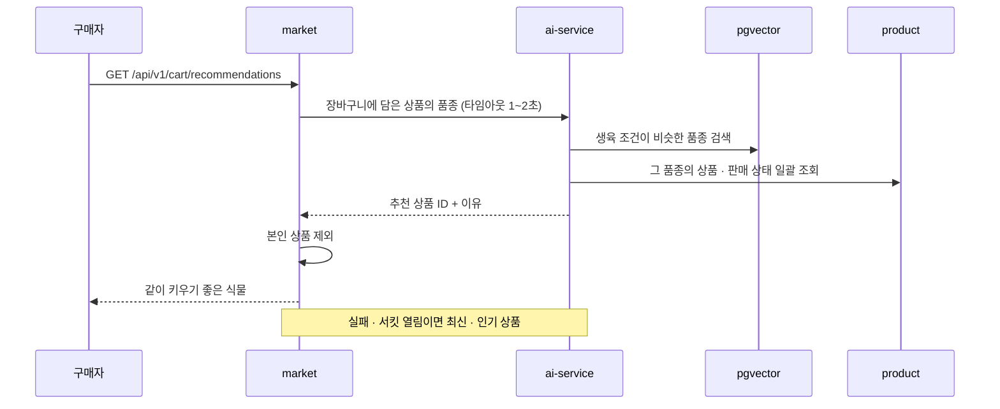

# 검색 · 추천

> 언제 읽나: OpenSearch 색인, 임베딩, 추천 코드를 고칠 때
> 상태: ✅ 확정 · 마지막 수정 2026-11-04 · 관련: Miro 17, 노션 기획안 「AI 추천 기능 설명」

## 검색 색인

product가 상품을 저장할 때 `product.events.v1`을 Outbox로 발행하고, **product 안의 색인 리스너**가 받아 OpenSearch에 반영합니다. 실패하면 재시도 · DLT. → [ADR 0005](../decisions/0005-opensearch-pgvector-external-embedding.md)

| 항목 | 내용 |
|---|---|
| 검색 대상 | 상품 제목 · 품종 이름(별칭 포함) · 판매자 닉네임 |
| 필터 | 품종 · 가격 · 관리 난이도 · 생육환경(빛, 물주기) |
| 정렬 | 최신 · 가격 |
| 한국어 분석기 | ⬜ `nori` · 인덱스 매핑 — 검색 담당 |

## 품종 임베딩

1. 품종 · 별칭이 바뀌면 product가 `species.events.v1`(`SpeciesProfileUpdated`)을 발행합니다 (처음 217종 1회, 이후 바뀐 품종만).
2. ai-service가 품종 문서(품종명 + 별칭 + 학명 + 생육 정보)를 외부 API로 임베딩합니다.
3. pgvector에 speciesId 기준으로 upsert합니다.

대상 문서는 품종 217개뿐이고, 이미지 기반 추천은 하지 않습니다.

## 추천

`ProductApproved`를 받으면 ai가 품종별 추천 후보에 상품을 넣습니다 (⬜ 이벤트 필드는 성수 님 확인 중).

## 의미 검색

사용자가 "햇빛 적은 방에서 키울 식물" 같은 문장으로 검색하면 product가 ai-service에 의미 검색을 요청해(1초) 상품 ID와 점수를 받아 키워드 결과와 합칩니다. 실패하면 키워드 결과만 돌려줍니다. ⬜ 내부 API 경로는 미정입니다.
