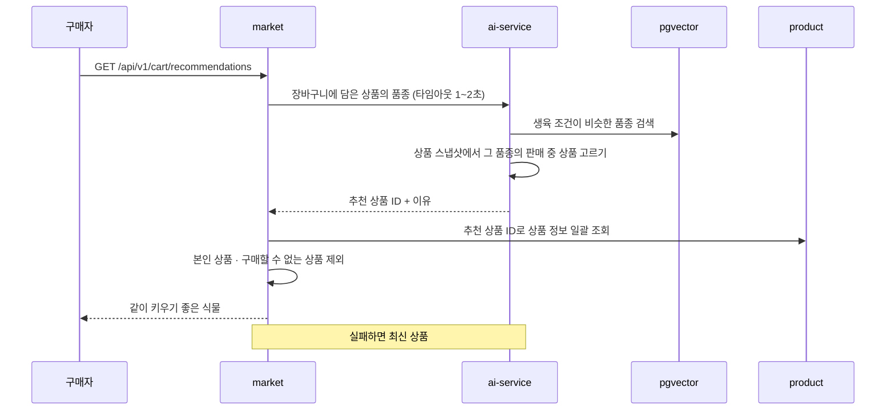

# 검색 · 추천

> 언제 읽나: OpenSearch 색인, 임베딩, 추천 코드를 고칠 때
> 상태: ✅ 확정 · 마지막 수정 2026-11-13 · 관련: Miro 17, 노션 기획안 「AI 추천 기능 설명」

## 검색 색인

원본은 PostgreSQL이고 OpenSearch는 언제든 다시 만들 수 있는 복사본입니다.

1. 상품 등록 · 수정 · 상태 변경 · 숨김 · 삭제는 같은 트랜잭션에서 Outbox에 "상품 변경(상품 ID)"을 저장합니다.
2. **product 안의 색인 리스너**가 받아 DB에서 최신 상품 · 품종명 · 별칭 · 학명을 읽어 문서를 덮어씁니다 (문서 ID = 상품 ID). 같은 이벤트가 두 번 와도 결과가 같습니다.
3. 반영까지 몇 초 걸릴 수 있습니다.
4. 별칭 · 학명 동의어가 바뀌면 배포 후 새 인덱스를 채우고 alias를 바꿔 전체 재색인합니다 (검색은 멈추지 않음).

| 항목 | 내용 |
|---|---|
| 검색 대상 | 검색 노출 규칙: `ACTIVE` · `PAYMENT_PENDING` · `SOLD_OUT`이면서 숨김이 아닌 상품 (`onSale=true`면 판매 중만) |
| 찾는 곳 | 제목 · 품종명 · 별칭 · 학명 (2단계부터 설명). 별칭이 여러 품종에 걸리면 모두 |
| 정규화 | 띄어쓰기 · 특수문자 · 대소문자 무시 ("몬 스테라" → 몬스테라) |
| 정렬 | 관련도(기본, 제목 > 품종명 · 별칭 > 설명) · 최신 · 가격 낮은순 · 높은순 |
| 오타 허용 (2단계) | 3 ~ 5글자는 1글자, 6글자 이상은 2글자. 1 ~ 2글자는 정확히 일치만 |
| 분석기 | `nori` |
| 페이지 | 기본 20, 최대 50 |
| OpenSearch 장애 | DB LIKE 검색으로 대신 (관련도 · 오타 · 한국어 분석 없음) |
| 범위 밖 | 사진 검색 · 상품 의미 검색 · 초성 검색 · 자동완성, 0건 검색어 기록 |

→ [ADR 0005](../decisions/0005-opensearch-pgvector-external-embedding.md)

## 품종 임베딩

1. ai가 농사로 자료로 자기 DB에 품종 프로필을 시드합니다 (품종 ID는 product `species.id`와 같음). product는 품종 이벤트를 발행하지 않습니다 → [ADR 0020](../decisions/0020-species-profile-ai-seed.md)
2. ai-service가 품종 문서(품종명 + 별칭 + 학명 + 생육 정보)를 외부 API로 임베딩합니다.
3. pgvector에 speciesId 기준으로 upsert합니다.

대상은 품종 목록(농사로 실내정원용 **215종**, 판매 금지 품종은 목록에서 빠짐)뿐이고, 이미지 기반 추천은 하지 않습니다.

## 추천

추천 대상은 판매 중(`ACTIVE`이고 숨김이 아님) 상품입니다. ai는 상품 이벤트(`ProductRegistered` · `ProductUpdated` · `ProductStatusChanged`)의 payload로 상품 스냅샷을 채우고(모든 상태), 추천할 때 판매 중만 고릅니다. ai는 product를 부르지 않고, 카드 정보(제목 · 가격 · 사진)는 market이 결과 ID로 조회합니다. market은 조회 결과에서 본인 상품과 함께 `isPurchasable()`이 false이거나 응답에 없는 상품도 뺍니다. 이벤트 반영이 늦어 스냅샷이 아직 판매 중이어도, 조회 시점에 판매 완료 · 숨김인 상품은 여기서 걸러집니다. 추천 이유는 템플릿 문장입니다 → [ADR 0021](../decisions/0021-product-event-payload-ai-snapshot.md)

## 의미 검색

상품 의미 검색은 **범위 밖**입니다. 문장으로 식물을 찾는 기능은 챗봇이 맡습니다 (⬜ 챗봇 범위 보류). product → ai 호출은 없습니다.
