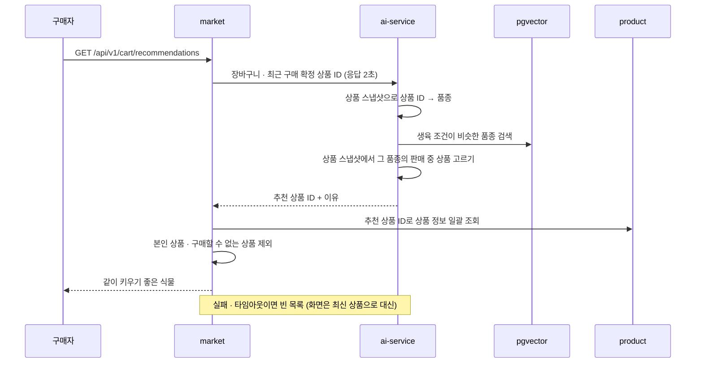
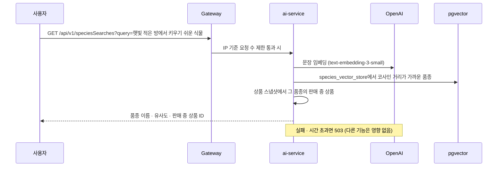

# 검색 · 추천

> 언제 읽나: OpenSearch 색인, 임베딩, 추천 코드를 고칠 때
> 상태: ✅ 확정 · 마지막 수정 2026-11-20 · 관련: Miro 17, 노션 기획안 「AI 추천 기능 설명」

## 검색 색인

원본은 PostgreSQL이고 OpenSearch는 언제든 다시 만들 수 있는 복사본입니다.

1. 상품 등록 · 수정 · 상태 변경 · 숨김 · 삭제는 같은 트랜잭션에서 Outbox에 "상품 변경(상품 ID)"을 저장합니다.
2. **product 안의 색인 리스너**(`ProductSearchIndexListener`)가 받아 DB에서 최신 상품 · 품종명 · 별칭 · 학명을 읽어 문서를 덮어씁니다 (문서 ID = 상품 ID). 이벤트 payload는 상품 ID만 쓰므로 같은 이벤트가 두 번 오거나 순서가 바뀌어도 결과가 같습니다. 삭제(`DELETED`) 상품은 문서를 지우고, 그 밖의 상태 · 숨김은 문서에 저장해 검색할 때 거릅니다.
3. 반영까지 몇 초 걸릴 수 있습니다.
4. 매핑 · 분석기나 별칭 · 학명 데이터가 바뀌면 배포 후 무중단 재색인 API로 새 인덱스를 채우고 alias를 바꿉니다 (검색은 멈추지 않음, 아래 「매핑 변경」).

| 항목 | 내용 |
|---|---|
| 검색 대상 | 검색 노출 규칙: `ACTIVE` · `PAYMENT_PENDING` · `SOLD_OUT`이면서 숨김이 아닌 상품 (`onSale=true`면 판매 중만) |
| 찾는 곳 | 제목 · 품종명 · 별칭 · 학명 · 설명(2단계). 별칭이 여러 품종에 걸리면 모두 |
| 정규화 | 띄어쓰기 · 특수문자 · 대소문자 무시 ("몬 스테라" → 몬스테라, "Mon-stera" → monstera). 한글 ↔ 영문("몬스테라" = "Monstera")은 정규화가 아니라 별칭 · 학명 필드로 찾음 |
| 정렬 | 관련도(기본, 제목 > 품종명 · 별칭 > 설명) · 최신 · 가격 낮은순 · 높은순 |
| 오타 허용 (2단계) | 3 ~ 5글자는 1글자, 6글자 이상은 2글자. 1 ~ 2글자는 정확히 일치만(`fuzziness` `AUTO:3,6`). 제목 · 품종명 · 별칭 · 학명의 `.word` 하위 필드에서 찾음(한국어 분석기는 모르는 단어를 다르게 잘라 "몬스테러" → 몬스 + 테러가 되므로 공백 단위로 비교). 오타로 맞으면 가중치 절반이라 정확히 맞는 상품이 앞. 설명은 오타 허용 안 함 |
| 분석기 | `nori`. 검색 필드마다 `ko_text`(기호를 공백으로) + `.compact` 하위 필드 `ko_compact`(공백 · 기호 제거). 제목 · 품종명 · 별칭 · 학명은 오타 허용용 `.word` 하위 필드 `ko_word`(기호를 공백으로, 공백으로만 자름)도 둠 |
| 인덱스 | alias `products` → 실제 인덱스 `products_v{n}` (문서 ID = 상품 ID). 처음은 `products_v1`, 무중단 재색인마다 번호 +1. 매핑은 번호와 상관없이 지금 코드의 `opensearch/products.json`. product가 뜰 때 alias가 없으면 `products_v1`을 만듦, OpenSearch가 꺼져 있으면 경고만 남기고 뜸 |
| 색인 이벤트 | `product.events.v1`의 `ProductRegistered` · `ProductUpdated` · `ProductStatusChanged`. `ProductApproved` · `ProductRejected`는 알림용이라 건너뜀(상태는 함께 나가는 `ProductStatusChanged`로 반영) |
| 쓰기 순서 | 외부 버전(`version_type=external`, 버전 = 상품 `version`): 저장된 버전보다 클 때만 반영, 같거나 작으면(409) 건너뜀. 전체 색인과 이벤트 색인이 겹쳐도 옛 값이 새 값을 덮지 않음. 쓰기는 `require_alias`라 alias가 없으면 실패(매핑 없는 `products` 인덱스가 자동으로 생기지 않게) |
| 색인 실패 | 공통 소비 설정대로 1 · 2 · 4초 재시도 후 `product.events.v1.DLT`. 상품 저장은 Outbox까지라 OpenSearch가 죽어도 등록 · 수정 API는 성공하고 색인만 늦어짐. 어긋난 문서는 전체 색인으로 맞춤 |
| 전체 색인 | 관리자 API `POST admin/products/searchIndex`: 상품을 id 순서로 500개씩 읽어 bulk로 씀. 처음 띄울 때 · 인덱스를 다시 만들 때 · DLT로 빠진 색인을 맞출 때. 상품 DB를 비우고 다시 시작하면(상품 id · 버전이 처음부터) 남은 문서의 버전이 더 커서 건너뛰므로 인덱스(`products_v*`)도 지운 뒤 앱을 다시 띄움 |
| 검색 API | `GET products`: `keyword`가 있으면 OpenSearch로 상품 id · 전체 개수만 받고 화면 값은 DB에서 다시 읽음(응답 형식이 DB 조회와 같고, 색인 지연 중 숨김 · 상태가 바뀐 상품은 한 번 더 거름). `keyword`가 없거나 `sellerId`가 있으면 DB 조회(원본이라 색인 지연이 없고 개수가 정확, 관련도가 필요 없음) |
| 판매자 상점 | `sellerId`(그 판매자 상품만) · `status`(노출 상태 중 하나 이상, 하나라도 밖이면 400). 판매 중 칸은 `status=ACTIVE&status=PAYMENT_PENDING`(결제 대기도 함께, 웹 시안 ShopB). 상점 안 검색창이 없어(웹 시안) 키워드가 있어도 DB 조회, 문서에 판매자는 색인하지 않음. 판매 완료 개수는 `sellerId` + `status=SOLD_OUT`의 전체 개수 |
| 페이지 | 기본 20, 최대 50 |
| OpenSearch 장애 | 연결 실패 · 시간 초과는 1번 더 보내고, 그래도 실패하거나 OpenSearch가 오류로 답하면(인덱스 없음 등) 경고 로그 후 DB LIKE 검색(제목 · 품종명 포함, 최신순)으로 대신 (관련도 · 오타 · 한국어 분석 없음) |
| 매핑 변경 | 관리자 API `POST admin/products/searchIndex/rebuilds`(무중단 재색인): `products_v{n+1}`을 alias 없이 만듦 → DB 전체를 채움(실패하면 새 인덱스를 지우고 멈춤, alias 그대로) → refresh → alias를 한 요청으로 옮김 → 그사이 옛 인덱스로 간 변경을 맞추는 전체 색인(같은 버전은 건너뜀) → 옛 인덱스 삭제(따라잡기 색인에 실패한 건이 있으면 옛 인덱스를 남김, `previousDeleted=false`: 전체 색인을 다시 실행해 맞춘 뒤 직접 지움). 그동안 검색 · 이벤트 색인은 옛 인덱스로 계속 됨. 전체 색인 · 재색인은 한 서버 안에서 한 번에 하나만(진행 중이면 409 `SEARCH_INDEXING_IN_PROGRESS`). 서버가 여럿이면 재색인끼리는 같은 새 인덱스 이름이 충돌해 뒤에 온 요청이 실패하지만, 다른 서버의 전체 색인과 겹치는 것은 막지 못하므로 재색인 중에는 전체 색인을 부르지 않음. 동기 실행이라 DB 전체를 두 번 읽음(상품이 많아지면 비동기 · 변경분만 반영 검토). 매핑을 바꾼 배포 뒤 한 번 부름(그 전에는 새 필드가 옛 인덱스에 없어 그 필드로는 안 찾힐 뿐 검색은 됨, 예: `.word` 오타 허용) |
| 범위 밖 | 사진 검색 · 상품 의미 검색 · 초성 검색 · 자동완성, 0건 검색어 기록 |

→ [ADR 0005](../decisions/0005-opensearch-pgvector-external-embedding.md)

## 품종 임베딩

1. ai가 농사로 자료로 자기 DB에 품종 프로필을 시드합니다 (품종 ID는 product `species.id`와 같음). product는 품종 이벤트를 발행하지 않습니다 → [ADR 0020](../decisions/0020-species-profile-ai-seed.md)
2. ai-service가 품종 문서(품종명 + 별칭 + 학명 + 생육 정보)를 외부 API로 임베딩합니다.
3. pgvector에 speciesId 기준으로 upsert합니다.

대상은 품종 목록(농사로 실내정원용 **215종**, 판매 금지 품종은 목록에서 빠짐)뿐이고, 이미지 기반 추천은 하지 않습니다.

## 추천

추천 대상은 판매 중(`ACTIVE`이고 숨김이 아님) 상품입니다. ai는 상품 이벤트(`ProductRegistered` · `ProductUpdated` · `ProductStatusChanged`)의 payload로 상품 스냅샷을 채우고(모든 상태), 추천할 때 판매 중만 고릅니다. ai는 product를 부르지 않고, 카드 정보(제목 · 가격 · 사진)는 market이 결과 ID로 조회합니다. market은 조회 결과에서 본인 상품과 함께 `isPurchasable()`이 false이거나 응답에 없는 상품도 뺍니다. 이벤트 반영이 늦어 스냅샷이 아직 판매 중이어도, 조회 시점에 판매 완료 · 숨김인 상품은 여기서 걸러집니다. 추천 이유는 템플릿 문장입니다 → [ADR 0021](../decisions/0021-product-event-payload-ai-snapshot.md)

추천 계산 규칙 (#294, `CartRecommendationService` · `RecommendationScorer`). 가중치 · 감점 폭은 🟨 출발값이고 추천 평가 세트(아래)로 조정합니다.

| 단계 | 규칙 |
|---|---|
| 요청 검증 | `size` 1~20, 목록 각 100개 이하 · ID는 1 이상(어기면 400). 목록이 `null`이면 빈 목록. 스냅샷에 없는 상품 ID는 무시. 받은 `size`만큼만 돌려줌(2배는 market이 함) |
| 기준 품종 | 장바구니 · 최근 구매 상품을 상품 스냅샷(모든 상태)으로 품종으로 바꾸고 중복 제거, 같은 무게. 「기타」(218)와 벡터가 없는 품종은 뺌. 기준 품종이 없으면 빈 목록 |
| 후보 | 기준 품종 벡터 평균과 코사인 거리가 가까운 품종 30개. 판매 중(`ACTIVE` · 숨김 아님, 장바구니 상품 제외) 상품이 있는 품종 안에서만 찾고, 기준 품종 자체는 뺌 |
| 점수 | 벡터 유사도(1 - 코사인 거리) 0.6 + 환경 점수 0.4. 환경 점수는 기준 품종마다 생육 온도 0.4(범위가 겹치면 1, 떨어지면 1℃마다 -0.1) + 광도 0.25(겹치면 1, 한 단계마다 -0.5) + 봄 물주기 0.2(같은 단계면 1, 한 단계마다 -0.5) + 분류 0.15(잎보기 · 꽃보기가 같으면 1, 다르면 0)의 평균, 값이 없는 항목은 0.5. 물주기 단계는 「흙이 물에 잠김 → 촉촉 → 표면이 마르면 → 대부분 마르면」, 분류는 「잎&꽃보기식물」 · 「꽃보기식물」을 꽃보기로 봄. 기준 품종이 모두 쉬움(`EASY`)이면 어려움(`HARD`) -0.1. 점수로 거르지는 않음 |
| 같은 속 | 빼지 않음. 점수 순서를 지키며 속마다 첫 품종을 앞에, 같은 속 두 번째부터는 뒤로 |
| 상품 | 품종을 순서대로 돌아가며 1개씩, 품종 안에서는 `product_id` 내림차순 |
| 이유 | 환경이 가장 잘 맞는 기준 품종 이름 + 겹치는 조건만: 「{품종}와 권장 광도 · 생육 온도가 겹쳐요」, 겹치는 조건이 없으면 「{품종}와 관리 방법이 비슷한 식물이에요」. 겨울 최저 온도는 견딜 수 있는 하한선이라 점수 · 문장에 쓰지 않음 |

추천 평가 세트 (#507): 정답 20쌍과 근거는 `services/ai/src/test/resources/recommendation/eval-pairs.csv`입니다. `RecommendationEvaluationTest`가 기준 품종 하나를 장바구니에 담고 모든 품종에 판매 중 상품이 있다고 보고, 위 규칙(후보 30개 → 점수 → 같은 속 분산)으로 Top-10 품종에 정답이 들어오는 수를 셉니다. 유사도는 실제 `text-embedding-3-small`로 내보낸 `eval-similarities.csv`를 쓰고(키 없이 CI에서 돎), 품종 문서나 임베딩 모델을 바꾸면 `EvalSimilarityExportTest`로 다시 내보냅니다. 적중 수가 기준(5)보다 줄면 테스트가 실패합니다.

| 비교 (2026-11-18) | Top-10 적중 | 바뀐 정답 순위 |
|---|---|---|
| 고치기 전 (생육 온도 0.6 + 광도 0.4) | 2 / 20 | 켄챠야자 2 · 뉴기니아봉선화 6 |
| 물주기 · 분류 추가 (반영) | 5 / 20 | 관음죽 15 → 9 · 헤미오니티스 14 → 5 · 마란타 13 → 5 · 뉴기니아봉선화 6 → 4. 러브체인 21 → 27 (물주기 「표면」 vs 「대부분」) |
| 물주기 감점 한 단계 -0.3 | 5 / 20 | -0.5와 같아 -0.5 유지 |
| 품종 문서에서 생육 조건 문구(광도 · 온도 · 물주기 · 습도 · 배치 장소 · 난이도 · 병충해 · 독성)를 빼고 재임베딩 | 3 / 20 | 스킨답서스 32위 → 17위로 들어왔지만 관음죽 · 마란타 · 러브체인이 밀려남. 반영 안 함 (품종 문서 그대로) |

정답 20쌍 중 13쌍은 벡터 순위가 30위 밖이라 점수 규칙과 관계없이 후보에 들지 못합니다(몬스테라 → 스킨답서스 32위 · 산세베리아 → 금전수 60위 등). 후보를 전체로 넓히면 산세베리아 → 금전수 62위 → 27위 · 시클라멘 → 아프리칸 바이올렛 54위 → 23위처럼 새 규칙에서 크게 오르지만 Top-10에는 들지 않습니다. 품종 문서에서 양식 문구를 빼 봐도 나아지지 않아(위 표) 품종 문서와 후보 수는 그대로 둡니다 (⬜ 다음 개선 후보).

| 추천 응답 | 화면 |
|---|---|
| 상품이 있음 | 「같이 키우기 좋은 식물」 · AI 추천 표시 · 카드마다 추천 이유(`reason`) |
| 빈 목록 (실패 · 타임아웃 · 결과 없음) | `GET /api/v1/products?onSale=true`(최신순)로 「새로 올라온 식물」. AI 추천 표시 · 이유 없음, 이미 담은 상품은 화면이 뺌 |
| 판매 중 상품도 없음 | 영역 숨김 |

추천 API는 계속 빈 목록을 돌려주고 최신 상품은 화면이 따로 부릅니다. 대체 상품을 추천과 구분해 추천 평가(#507)에 섞이지 않게 합니다 → [ADR 0029](../decisions/0029-cart-recommendation-latest-fallback-on-screen.md)

상품 스냅샷은 상품 이벤트로만 채웁니다. 초기 적재는 하지 않습니다 (상품 데이터를 비우고 시작, 시연 상품도 SQL이 아니라 상품 등록 API로 넣어 이벤트가 나가게 함). Kafka 보관(7일)이 지난 뒤 ai DB를 잃으면 product의 「전체 상품 이벤트 재발행」 운영 API로 다시 채웁니다 → [product 카드](../services/product.md)

## 의미 검색

상품 의미 검색은 **범위 밖**입니다. 문장으로 식물을 찾는 기능은 챗봇이 맡습니다 (⬜ 챗봇 범위 보류). product → ai 호출은 없습니다.

**품종 의미 검색** (#570): 사용자가 쓴 문장으로 품종을 찾습니다. 상품 문서가 아니라 품종 문서(위 「품종 임베딩」)를 찾고, 챗봇과 별개입니다 → [ADR 0030](../decisions/0030-species-semantic-search-pgvector.md)

| 항목 | 내용 |
|---|---|
| 입력 | `query` 앞뒤 공백을 지우고 2 ~ 100자(밖이면 400 `INVALID_SEARCH_QUERY`, OpenAI를 부르지 않음). `size` 1 ~ 10, 기본 5(밖이거나 숫자가 아니면 400 `INVALID_SEARCH_SIZE`) |
| 질의 벡터 | 품종 임베딩과 같은 모델 · 차원([ADR 0024](../decisions/0024-embedding-openai-text-embedding-3-small.md)). 문장은 저장 · 로그하지 않음 |
| 품종 | `species_vector_store`에서 코사인 거리 순(HNSW) `size`개, 유사도(1 - 코사인 거리)가 최소 유사도 🟨 0.35(`custom.species-search.min-similarity`) 미만이면 뺌. 2026-11-20 로컬 실측(질문 18개, 1위 유사도): 결과가 맞는 질문은 0.36 ~ 0.56(「몬스테라 같은 큰 잎 식물」 0.562 · 「햇빛 적은 방에서 키우기 쉬운 식물」 0.362), 목록에 없는 식물 · 관계없는 질문은 0.15 ~ 0.34(「로즈마리 키우는 법」 0.342 · 「오늘 서울 날씨 어때?」 0.329)라 그 사이로 정함. 경계 폭이 좁아(0.02) 다른 질문에서는 틀릴 수 있음. 품종 문서가 같은 양식이라 어떤 문장이든 0.3 안팎이 나오는 한계이고, 전체 품종 평균 유사도와의 차이로 거르는 안은 관계없는 질문이 오히려 높게 나와(날씨 +0.168 > 햇빛 +0.108) 버림. 목록에 없는 식물을 확실히 거르는 것은 범위 밖(챗봇이 맡을 일) 이름은 품종 프로필. 판매 중 상품이 없는 품종도 보여 줌 |
| 상품 | 품종마다 상품 스냅샷의 판매 중(`ACTIVE` · 숨김 아님) 상품을 `product_id` 내림차순 3개까지. 카드 정보(제목 · 가격 · 사진)는 화면이 `GET products/{id}`로 조회 |
| 결과 없음 | 빈 목록 (200) |
| 장애 | OpenAI 실패 · 시간 초과는 재시도 없이 503 `SEMANTIC_SEARCH_UNAVAILABLE` → [장애 대응](../conventions/resilience.md). 추천 · 재임베딩 · 이벤트 구독은 영향 없음 |
| 비용 보호 | 공개 API라 Gateway가 IP 기준 요청 수 제한 → [Gateway](../services/gateway.md) |
