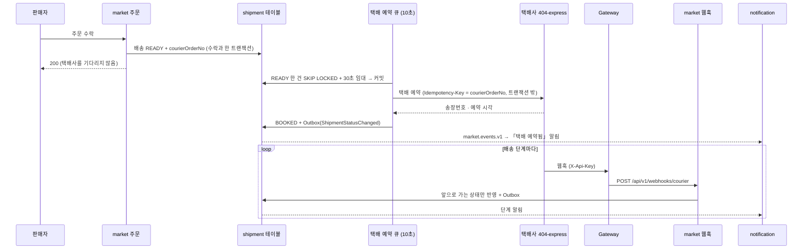
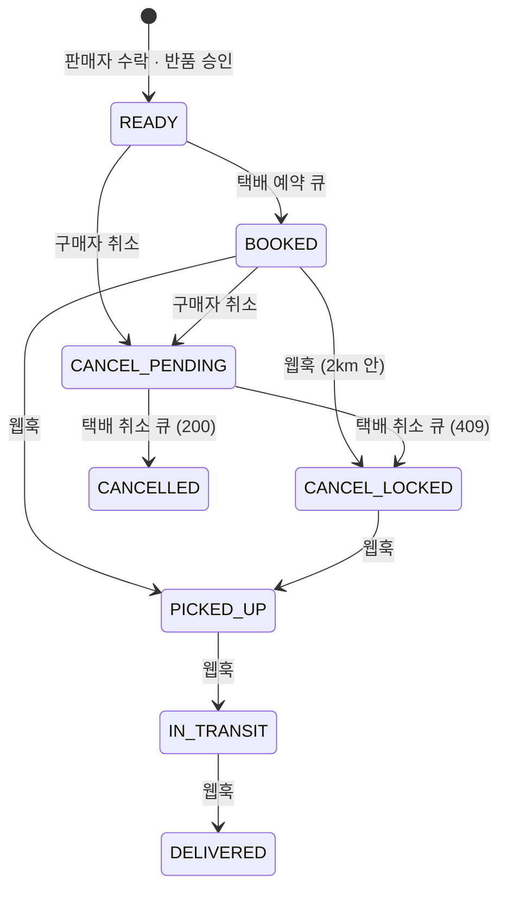

# 배송

> 언제 읽나: 배송을 처음 볼 때(인수인계 · 면접 대비), 택배 예약 · 웹훅 · 반품 배송 · 배송비 코드를 고칠 때
> 상태: ✅ 확정 · 마지막 수정 2026-11-24 · 관련: [ADR 0013](../decisions/0013-shipment-after-seller-accept.md) · [ADR 0026](../decisions/0026-courier-cancel-queue-and-distance-judgment.md), [market](../services/market.md), 404-express 레포 `docs/design.md`

배송이 언제 생기고, 누가 택배사를 부르고, 상태가 어떻게 바뀌고, 실패하면 어떻게 되는지 한 번에 보는 문서입니다. 값(주기 · 타임아웃 · 경로 · 토픽)은 원본 문서로 링크합니다. 코드는 `services/market/.../market/shipment/`에 있습니다.

## 한눈에 보기

| 등장인물 | 하는 일 |
|---|---|
| 구매자 | 주문 · 결제, 수락 뒤 취소, 배송 조회, 반품 신청 |
| 판매자 | 주문 수락 · 거절, 반품 승인 · 거절, 배송 조회 |
| market (주문) | 수락 · 취소 · 반품 승인 트랜잭션 안에서 배송 행만 만들거나 바꿈. 택배사는 부르지 않음 |
| market (배송) | 택배 예약 큐 · 택배 취소 큐가 택배사를 부르고, 웹훅으로 배송 상태를 바꾸고, `ShipmentStatusChanged`를 Outbox로 발행 |
| 택배사 (404-express) | 택배 예약 · 취소 판정 · 배송 진행 시뮬레이션, 단계마다 웹훅 (개인 레포 `gasic37200/404-express`) |
| Gateway | 택배 웹훅을 market으로 넘기는 공개 경로 |
| notification | `ShipmentStatusChanged`를 받아 구매자 · 판매자에게 알림 |



## 배송이 생기는 시점

배송은 **결제 직후가 아니라 판매자가 수락한 뒤** 생깁니다 → [ADR 0013](../decisions/0013-shipment-after-seller-accept.md)

| 언제 | 무엇이 생기나 | 코드 |
|---|---|---|
| 판매자 수락 (일부 거절 뒤 수락 포함) | 가는 길 배송 `READY` 1개, 수락된 주문상품만 상품 요약에 담음 | `SellerOrderDecisionTransactions` → `ShipmentService.createShipment` |
| 반품 승인 (판매자 · 자동 승인) | 반품 배송 `READY` 1개, 그 주문상품만 | `OrderReturnService` → `ShipmentService.createReturnShipment` |
| 전부 거절 · 자동 거절 · 수락 전 취소 | 배송 없음 (택배사를 부르지 않고 바로 환불) | [취소 · 환불](cancel-refund.md) |

- 왜 수락 뒤인가: 재고가 없거나 식물 상태가 나쁜 판매자가 택배가 오기 전에 거절할 수 있어야 해서입니다 (판매자 취소 기능은 철회).
- 수락 트랜잭션은 배송 행과 택배 주문번호 `courierOrderNo`만 저장하고 끝납니다. 택배사가 느리거나 죽어도 수락 응답은 영향을 받지 않습니다.
- `courierOrderNo` 형식은 [market 정책 「택배 예약」](../services/market.md#정책)에 있습니다 (`shipment-{배송 생성일}-{배송ID 6자리}`). 이 값이 택배사 멱등 키입니다.

## 택배 예약 큐

`READY` 배송(반품 배송 포함)을 택배사에 예약하는 스케줄러입니다. 주기 · 건수 · 재시도 간격의 원본은 [스케줄러 표 「택배 예약 큐」](../reference/schedulers.md), 타임아웃은 [resilience](../conventions/resilience.md)입니다.

| 단계 | 하는 일 | 왜 |
|---|---|---|
| 1. 확보 | 짧은 트랜잭션에서 `status = 'READY'`이고 `next_attempt_at`이 지난 행 1개를 `FOR UPDATE SKIP LOCKED`로 읽고, `next_attempt_at`을 30초 뒤로 미룸(임대) → 바로 커밋 | 다른 파드가 잠근 행은 기다리지 않고 건너뜀. 커밋 뒤에도 30초 동안은 다른 파드가 다시 집지 않음 |
| 2. 호출 | **트랜잭션 밖에서** 주문 배송지 · 판매자 기본 배송지를 읽어 택배사 `POST /api/v1/shipments` (`Idempotency-Key = courierOrderNo`) | 택배사를 기다리는 동안 DB 커넥션을 잡지 않음 |
| 3. 저장 | 성공: 짧은 트랜잭션에서 `BOOKED` + 송장번호 · 예약 시각 + Outbox `ShipmentStatusChanged` | 상태와 이벤트가 같이 커밋 |
| 3'. 실패 | 최신 행을 다시 읽어 아직 `READY`면 `attempt_count` +1, `last_error`, 다음 시도 시각(10초 → 30초 → 1분 고정) | 포기하지 않음. 같은 `courierOrderNo`로 다시 보내도 택배사가 한 번만 만듦 |

한 번 실행에 위 과정을 최대 20번 반복합니다(`BOOKING_BATCH_SIZE`). 파드 2개(→ [ADR 0014](../decisions/0014-gateway-market-k3s-two-pods.md))가 함께 돌아도 SKIP LOCKED + 임대 + 멱등 키로 같은 배송을 두 번 예약하지 않습니다.

보내는 쪽 · 받는 쪽:

| 배송 방향 | 보내는 쪽 | 받는 쪽 |
|---|---|---|
| 가는 길 `OUTBOUND` | 판매자 기본 배송지 (`MEMBER_REPLICA` 암호문을 그때 복호화) | 주문 배송지 |
| 반품 배송 `RETURN` | 주문 배송지 (구매자) | 판매자 기본 배송지 |

### 왜 큐인가

| 시점 | 구조 | 측정 결과 | 근거 |
|---|---|---|---|
| 세미 (모놀리스) | 주문 커밋 직후 `afterCommit`에서 요청 스레드가 택배 예약 | 주문 5건/초 통과, 10건/초에서 멈춤. 예약이 두 번째 DB 커넥션을 빌리며 커넥션 풀 교착(스레드 덤프로 확인), 택배 지연 3초면 2건/초 | #351 · PR #398 |
| 큐로 변경 | 요청은 배송 행만 쓰고, 10초 큐가 트랜잭션 밖에서 호출 | 예약 쪽 교착 원인 제거 | PR #478 |
| MSA 운영 재측정 | 같은 k6 시나리오 | 주문 10건/초 통과(세미 5), 교착 없음, CPU가 새 한계 | PR #629 |

택배 취소도 같은 이유로 같은 큐 구조입니다 (→ [택배 취소](#택배-취소)).

## 배송 상태

`ShipmentStatus`의 선언 순서가 곧 진행 순서이고, 웹훅은 **앞으로만** 반영합니다. 화면 문구 · 정책은 [market 정책 「배송 상태」](../services/market.md#정책)가 원본입니다.

| 상태 | 뜻 | 누가 바꾸나 | 다음 |
|---|---|---|---|
| `READY` | 배송 행만 있음, 택배사에 예약 전 | 수락 · 반품 승인 트랜잭션이 만듦 | `BOOKED`, `CANCEL_PENDING` |
| `BOOKED` | 택배 예약 (송장번호 있음) | 택배 예약 큐 | `CANCEL_LOCKED`, `PICKED_UP`, `CANCEL_PENDING` |
| `CANCEL_LOCKED` | 취소 불가: 기사가 수거지 2km 안 | 웹훅, 또는 택배 취소 큐(택배사가 409로 거절) | `PICKED_UP` |
| `PICKED_UP` | 수거. 이후 취소 대신 반품 | 웹훅 | `IN_TRANSIT`, `DELIVERED` |
| `IN_TRANSIT` | 배송 중 (간선 출발) | 웹훅 | `DELIVERED` |
| `DELIVERED` | 배송 완료. 자동 구매 확정 · 반품 기간의 기준 | 웹훅 | 끝 |
| `CANCEL_PENDING` | 취소 대기: 택배사 취소 결과를 기다림 | 구매자 취소(주문 트랜잭션) | `CANCELLED`, `CANCEL_LOCKED` |
| `CANCELLED` | 취소됨 (반송 포함) | 택배 취소 큐 | 끝 |



`CANCEL_PENDING` · `CANCELLED`는 enum 맨 끝에 있어서, 취소가 시작된 뒤에는 진행 웹훅이 상태를 바꾸지 못합니다. 취소 결과는 택배 취소 큐만 정합니다.

## 택배 웹훅

택배사 → Gateway(공개 경로) → market `POST /api/v1/webhooks/courier`. 요청 칸 · 응답 코드는 [외부 API](../reference/external-apis.md), 택배사 재전송 규칙은 [market 정책 「택배 웹훅」](../services/market.md#정책)에 있습니다.

| 경우 | market 처리 | 응답 |
|---|---|---|
| `X-Api-Key`가 다름 | 처리 안 함 (상수 시간 비교) | 401 |
| `status = SHIPPING_FEES_CHANGED` | 배송비 요금표 저장 (→ [배송비](#배송비)) | 200 |
| `CANCEL_LOCKED` · `PICKED_UP` · `IN_TRANSIT` · `DELIVERED` | `applyCourierStatus`: 지금보다 뒤 단계면 반영 + 단계 시각 + Outbox, 아니면 무시 | 200 |
| 같은 · 이전 단계 (중복 · 순서 뒤바뀜) | 로그만 | 200 |
| 모르는 `courierOrderNo` · 그 밖의 택배사 단계 | 로그만 | 200 |

- 택배사는 `NEAR_5KM` · `ARRIVED_ORIGIN` · `ARRIVED_DEST` · `OUT_FOR_DELIVERY` · `CANCELLED` · `RETURNING` · `RETURNED`도 보내지만 market 배송 상태에는 없는 단계라 반영하지 않습니다. 남은 거리 · 지점 같은 세부 단계는 [배송 조회](#배송-조회)가 그때그때 택배사에 묻습니다.
- 중간 웹훅을 놓쳐 단계를 건너뛰면 그 단계 시각은 비어 있습니다. 예약 응답을 놓쳤으면 웹훅의 송장번호로 채웁니다.
- 처리 중 예외가 나면 200이 아니어서 택배사가 다시 보냅니다. 다시 와도 「앞으로만」 규칙 때문에 결과는 같습니다.

### 예약 저장보다 웹훅이 먼저 오는 경우

판매자가 집하점 2km 안이면 택배사는 예약하자마자 `CANCEL_LOCKED` 웹훅을 보냅니다. 그러면 택배 예약 큐의 3단계 저장이 `@Version` 충돌로 실패합니다.

| 최신 행 상태 | `recoverBookingConflict` 처리 |
|---|---|
| `CANCEL_LOCKED` 등 이미 앞으로 간 상태, `bookedAt` 없음 | `fillMissedBooking`: 송장번호 · 예약 시각만 채우고, 판매자에게 「택배 예약됨」 알림이 가도록 `BOOKED` 이벤트 발행 (상태는 그대로) |
| `CANCEL_PENDING` · `CANCELLED` (그사이 구매자 취소) | 아무것도 안 함. 택배사 예약은 택배 취소 큐가 주문번호로 취소 |
| 또 충돌 | 알림만 포기 (상태는 웹훅이 이미 맞게 반영) |

## 택배 취소

구매자 취소의 전체 흐름(환불 · Saga 복구)은 [취소 · 환불 「수거 전 취소」](cancel-refund.md#수거-전-취소)가 원본입니다. 여기서는 배송 쪽만 봅니다 → [ADR 0026](../decisions/0026-courier-cancel-queue-and-distance-judgment.md)

| 단계 | 하는 일 |
|---|---|
| 1. 취소 기록 | 판매자 주문의 모든 상품이 취소되면 주문 트랜잭션 안에서 `ShipmentService.cancelShipment`: 가는 길 배송 행을 잠그고 `READY` · `BOOKED`면 `CANCEL_PENDING` + 누른 시각 `cancel_requested_at`. 택배사는 부르지 않음 |
| 2. 즉시 거절 | `CANCEL_LOCKED` · 수거 이후면 `SHIPMENT_NOT_CANCELABLE`. 이미 취소 중이면 처음 누른 시각 유지 |
| 3. 택배 취소 큐 | 예약 큐와 같은 방식(SKIP LOCKED · 30초 임대 · 트랜잭션 밖)으로 `POST /api/v1/shipments/byOrderNo/{courierOrderNo}/cancel` + 누른 시각 |
| 4. 결과 저장 | 200 → `CANCELLED`(택배사가 `returning`이면 반송), 409 → `CANCEL_LOCKED`. 배송 상태와 `SHIPMENT_CANCEL_RESULT` 행을 한 트랜잭션에. 주문 Saga 복구가 이 행을 읽어 환불하거나 되돌림 |

- 2km 판정은 택배사가 **구매자가 누른 시각**의 기사 거리로 합니다. 큐가 늦게 보내도 구매자에게 불리하지 않습니다.
- 송장번호가 없는 `READY` 취소도 주문번호로 보냅니다. 택배사는 「취소됨」을 기록하고, 늦게 도착한 같은 주문번호 예약은 받지 않습니다.
- 수거 뒤에는 구매자가 취소할 수 없고 반품으로 갑니다. 「반송」은 판정상 취소가 맞는데 택배사 장애로 이미 수거된 경우에만 택배사 비용으로 일어납니다.
- 반품 배송은 취소할 수 없습니다 (가는 길 배송만 찾음).

## 반품 배송

반품 신청 · 승인 · 환불 정책은 [취소 · 환불 「반품 환불」](cancel-refund.md#반품-환불)이 원본입니다.

| 항목 | 내용 |
|---|---|
| 만드는 때 | 반품 승인(판매자 · 48시간 자동 승인) 트랜잭션 |
| 단위 | 주문상품마다 새 배송 행 (`direction = RETURN`). 판매자 주문 하나에 가는 길 배송은 1개(부분 유니크 인덱스), 반품 배송은 여러 개 |
| 연결 | `return_request.shipment_id`가 반품 배송을 가리킴 |
| 예약 | 같은 택배 예약 큐가 집음. 보내는 쪽 · 받는 쪽만 바뀜 (→ [택배 예약 큐](#택배-예약-큐)) |
| 상태 반영 | 같은 웹훅 · 같은 「앞으로만」 규칙 |
| 알림 | `ShipmentStatusChanged`를 발행하지 않음 (받는 쪽이 가는 길 기준으로 알림을 만들기 때문). 반품 알림은 `ReturnApproved` 등 반품 이벤트로 |
| 도착 뒤 | 택배 웹훅은 주문을 부르지 않음. 주문 Saga 복구의 「반품 도착 처리」가 반품 배송 `DELIVERED`를 읽어 반품 환불로 넘김 |

## 배송 조회

판매자 · 구매자가 가는 길 배송과 반품 배송의 단계를 보는 API입니다. 경로 · 응답 칸은 [외부 API](../reference/external-apis.md), 타임아웃은 [resilience](../conventions/resilience.md)에 있습니다.

| 항목 | 내용 |
|---|---|
| 단계별 시각 | market `shipment` 행 값 (`bookedAt` · `pickedUpAt` · `inTransitAt` · `deliveredAt`) |
| 남은 거리 · 지점 · 세부 단계 | 택배사 `GET /api/v1/shipments/byOrderNo/{courierOrderNo}`를 그때 불러 보탬. `BOOKED` · `CANCEL_LOCKED` · `PICKED_UP` · `IN_TRANSIT` · `CANCEL_PENDING`일 때만 물음 (`READY`는 예약 전, `DELIVERED` · `CANCELLED`는 끝남) |
| 택배사 실패 · 시간 초과 | 택배사 값만 null, 응답은 200. 재시도 없음 (안내용) |
| DB 트랜잭션 | 일부러 없음. 배송 행을 읽은 뒤 커넥션을 놓고 택배사를 부름 |
| 반품 배송 | 수거 전 거리는 기사 → 구매자 (보내는 쪽이 구매자라서) |

## 배송비

배송비 계산 규칙(기본 + 지역 할증 하나, 판정 순서)은 [market 정책 「배송비」](../services/market.md#정책)가 원본입니다.

| 조각 | 하는 일 | 원본 |
|---|---|---|
| 배송비 요금표 `SHIPPING_FEE_TABLE` | 택배사가 준 요금표를 버전마다 한 행으로 쌓음. 같거나 낮은 버전은 무시 | [market 소유 테이블](../services/market.md#소유-테이블) |
| 요금표 변경 웹훅 | `SHIPPING_FEES_CHANGED`로 요금표 전체를 받아 저장 | [택배 웹훅](#택배-웹훅) |
| 요금표 버전 대사 | 매일 09:30 택배사 `GET /api/v1/shippingFees`와 버전 비교, 다르면 저장. ShedLock으로 파드 한 곳만 | [스케줄러 표](../reference/schedulers.md) |
| 요금표가 아직 없을 때 | 3,000원 (일반 지역, 할증 0) | `ShippingFeeTableService` |
| 배송비 미리 계산 | 주문서에서 배송지를 고르면 판매자별 배송비. 주문 생성과 같은 계산(`ShippingFeeQuote`) | [외부 API](../reference/external-apis.md) |
| 주문 생성 비교 | 프론트가 본 `expectedShippingFee`가 서버 계산과 다르면 409 `SHIPPING_FEE_CHANGED` | [주문 · 결제](order-payment.md) |

배송비는 주문을 만들 때 판매자 주문마다 저장합니다. 새 요금표는 받은 뒤 생성되는 주문부터 쓰입니다.

## 실패와 재시도

| 실패 | 어떻게 되나 | 사람이 볼 곳 |
|---|---|---|
| 택배사 5xx · 408 · 429 · 시간 초과 · 연결 실패 (예약) | `READY` 유지, 10초 → 30초 → 1분 고정으로 끝까지 재시도. `warn` 로그 | `last_error` |
| 택배사 4xx 거절 (예약) | **위와 똑같이 끝까지 재시도.** `error` 로그만 다름 | `last_error`, 알림 |
| 판매자 배송지 없음 (복제본 · 암호문 · 기본 주소 없음) | 예약 보류, `READY` 유지하고 같은 주문번호로 재시도. `warn` 로그 | `last_error` |
| 택배사 실패 (취소) | 409 말고는 결과를 모르므로 `CANCEL_PENDING` 유지, 같은 간격으로 끝까지 재시도 | `last_error`, 알림 |
| 취소 결과 저장 실패 | 다음 시도에서 같은 주문번호로 다시 보냄. 택배사 취소가 멱등이라 같은 결과 | 로그 |
| 웹훅이 market에 안 닿음 | 택배사가 1분 → 5분 → 30분 → 2시간 → 6시간 재전송, 다 실패하면 택배사 `DEAD` 목록. 배송 상태는 그 단계에서 멈춤 | 404-express `admin/webhooks?status=DEAD` |
| 요금표 웹훅 실패 | 다음 날 09:30 버전 대사가 맞춤 | 로그 |
| 배송 조회 중 택배사 실패 | 택배사 값만 null | 로그 |

- 알림: 「배송 예약 · 취소 지연」 — 만든 지 10분 넘게 `READY`이거나 취소를 누른 지 10분 넘게 `CANCEL_PENDING`인 배송이 1건 이상이면 Slack으로 한 번. 지표 `replant_shipment_stuck{status}` → [관측 「알림 규칙」](../infra/observability.md)
- 서킷 브레이커는 쓰지 않습니다 → [ADR 0011](../decisions/0011-no-circuit-breaker.md)

### 알려진 한계

| 한계 | 지금 | 영향 |
|---|---|---|
| 4xx도 끝없이 재시도 | `CourierBookingException.retryable`은 로그 수준(`warn` / `error`)만 가름. 큐는 4xx(잘못된 주소 등)도 1분마다 계속 보냄 | 고칠 수 없는 요청이 `READY`로 남아 1분마다 택배사를 부르고, 「배송 예약 · 취소 지연」 알림이 켜진 채로 남음. 사람이 `last_error`를 보고 처리해야 함 |

## 운영 · 디버깅

비밀값(`X-Api-Key` · `X-Admin-Key` · DB 비밀번호)은 이 문서에 적지 않습니다. 값의 위치는 [환경변수](../reference/env-vars.md)에 있습니다.

DB에서 배송 보기 (market DB):

```sql
-- 판매자 주문의 배송 (가는 길 + 반품)
select id, direction, status, courier_order_no, tracking_no,
       booked_at, picked_up_at, in_transit_at, delivered_at, cancelled_at,
       next_attempt_at, attempt_count, last_error, cancel_requested_at
from shipment
where seller_order_id = :sellerOrderId
order by id;

-- 큐에 오래 남은 배송 (알림 「배송 예약 · 취소 지연」의 원인 찾기)
select id, status, attempt_count, next_attempt_at, last_error
from shipment
where status in ('READY', 'CANCEL_PENDING')
order by created_at;

-- 반품 신청과 반품 배송
select r.id, r.order_item_id, r.status, s.status as shipment_status, s.courier_order_no
from return_request r
left join shipment s on s.id = r.shipment_id
where r.order_item_id = :orderItemId;
```

404-express에 묻기 (택배사 경로 · 인증은 404-express 레포 `docs/design.md`):

| 하고 싶은 것 | 호출 |
|---|---|
| 택배사가 보는 상태 · 남은 거리 | `GET /api/v1/shipments/byOrderNo/{courierOrderNo}` (`X-Api-Key`) |
| 시연 · 테스트로 한 단계 진행 | `POST /api/v1/admin/shipments/{trackingNo}/advance` (`X-Admin-Key`) |
| 못 보낸 웹훅 보기 · 다시 보내기 | `GET /api/v1/admin/webhooks?status=DEAD`, `POST /api/v1/admin/webhooks/{eventId}/retry` (`X-Admin-Key`) |

Grafana Loki 쿼리 예시 (라벨 `service`는 k3s 파드의 `app` 라벨, compose 서비스 이름):

```logql
{service="market"} |= "택배 예약 실패"
{service="market"} |= "shipment-20261124-000123"
{service="market"} |= "반영하지 않은 웹훅"
{service="404-express"} |= "shipment-20261124-000123"
```

## 더 읽을 곳

| 문서 | 내용 |
|---|---|
| [ADR 0013](../decisions/0013-shipment-after-seller-accept.md) | 판매자가 수락해야 배송을 만든다 |
| [ADR 0026](../decisions/0026-courier-cancel-queue-and-distance-judgment.md) | 택배 취소 큐와 누른 시각 기준 거리 판정 |
| [취소 · 환불](cancel-refund.md) | 수거 전 취소 · 반품 환불 전체 흐름 |
| [주문 · 결제](order-payment.md) | 배송비 비교 · 주문 생성 |
| [market](../services/market.md) | 소유 테이블 · 정책 (배송 상태 · 택배 예약 · 택배 웹훅 · 배송비) |
| [외부 API](../reference/external-apis.md) · [스케줄러](../reference/schedulers.md) · [resilience](../conventions/resilience.md) · [Kafka 토픽](../reference/kafka-topics.md) | 경로 · 주기 · 타임아웃 · 이벤트 칸 |
| 404-express 레포 `docs/design.md` | 택배사 단계 · 거리 시뮬레이션 · 취소 판정 · 웹훅 재전송 |
