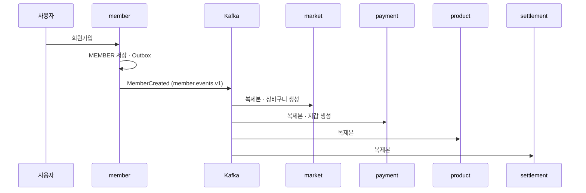

# 가입과 회원 복제본

> 언제 읽나: 가입 · 회원 정보 변경이 다른 서비스에 퍼지는 흐름을 볼 때
> 상태: ✅ 확정 · 마지막 수정 2026-11-04 · 관련: Miro 5 · 9

## 흐름

주소는 `member.address.events.v1` → market만, 계좌는 `member.account.events.v1` → payment만 받습니다 → [ADR 0004](../decisions/0004-member-replica-three-topics.md)

## 복제본이 아직 없을 때

가입 직후 이벤트보다 요청이 먼저 오면 복제본이 없을 수 있습니다. 이때 장바구니 · 지갑은 **JWT의 memberId로 get-or-create**합니다. 받는 쪽 리스너도 upsert라 나중에 온 이벤트와 충돌하지 않습니다 (S-B03).

## 탈퇴

1. member가 탈퇴 가능 여부를 확인합니다 (진행 중 주문 · 환불, 정산 대기금이 있으면 막음, Fail-closed).
2. 소프트 삭제하고 닉네임을 "탈퇴한 회원"으로 바꿉니다.
3. `auth:revoked-member:{memberId}`를 기록해 모든 기기 토큰을 끊고 Refresh를 일괄 삭제합니다.
4. `MemberWithdrawn`을 발행해 각 서비스 복제본을 탈퇴 상태로 바꿉니다.

⬜ 1번 확인에 쓸 내부 API(payment · market · settlement)는 아직 목록에 없습니다.
