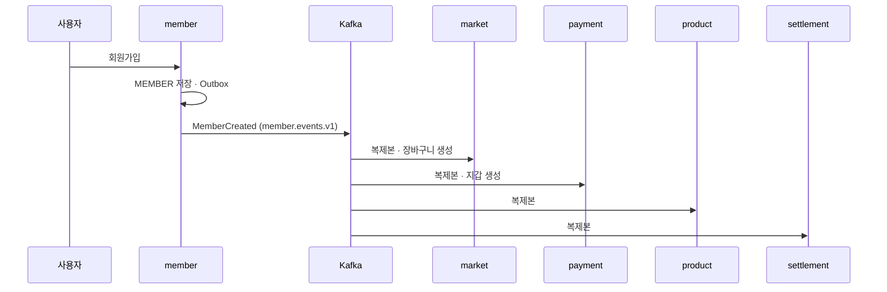

# 가입과 회원 복제본

> 언제 읽나: 가입 · 회원 정보 변경이 다른 서비스에 퍼지는 흐름을 볼 때
> 상태: ✅ 확정 · 마지막 수정 2026-11-25 · 관련: Miro 5 · 9

## 흐름

- 복제본은 닉네임 · 권한 · 판매자 여부입니다.
- **판매자 배송지 목록**은 `member.address.events.v1`로 market만 받습니다 (암호화). 판매자 등록 · 배송지 추가 · 기본 배송지 변경 때 바뀐 뒤 전체 목록을 보내고, 판매자는 주문 수락 때 이 중에서 보내는 주소를 고릅니다 → [payload](../reference/kafka-topics.md#payload)
- **계좌는 복제하지 않습니다.** payment가 인출할 때 member 내부 API로 조회합니다 → [ADR 0015](../decisions/0015-member-topics-two-account-api.md)

## 복제본이 아직 없을 때

가입 직후 이벤트보다 요청이 먼저 오면 복제본이 없을 수 있습니다. 이때 장바구니 · 지갑은 **JWT의 memberId로 get-or-create**합니다. 받는 쪽 리스너도 upsert라 나중에 온 이벤트와 충돌하지 않습니다 (S-B03).

## 탈퇴

결정 배경 → [ADR 0028](../decisions/0028-member-withdrawal-kakao-unlink-policy.md)

| 단계 | 내용 |
|---|---|
| 막는 조건 | 구매 확정 전 주문(구매 · 판매, 결제 대기 · 판매자 수락 대기 포함), 예치금 잔액, 진행 중 충전 · 충전 취소 · 인출, 미지급 정산, 미수금 |
| 확인 | market · payment · settlement 내부 API 3개를 **병렬** 호출 (`GET /internal/v1/{orders, payments, settlements}/members/{memberId}/withdrawalCheck`, 공통 응답 `hasWithdrawalBlocker` · `blockingReasons` · `details`). 결과는 `ALLOWED` · `BLOCKED` · `UNAVAILABLE`이고 **탈퇴는 `ALLOWED`일 때만** 진행. 호출 실패 · 응답 형식 오류(값 누락, 차단 여부와 사유 불일치)는 `UNAVAILABLE`(Fail-closed), 차단과 실패가 함께면 `UNAVAILABLE` |
| 잔액 | 회원이 탈퇴 전에 직접 정리 (토스 취소 기한 안은 충전 취소, 나머지는 계좌 인출). 정리를 시작하면 지갑이 잠김 |
| 다른 서비스 | 복제본은 지우지 않고 탈퇴 상태로 ("탈퇴한 회원"). product는 판매 중 · 검수 중 · 반려 상품을 `DELETED` |
| 한계 | 3곳 확인은 읽기 전용이라 확인 이후의 다른 서비스 변경은 막지 못함: 본인이 충전하면 잔액이 남을 수 있음(운영자가 처리). 또 확인부터 `MemberWithdrawn`이 소비돼 product의 상품 정리가 반영될 때까지(카카오 연결 해제 · 이벤트 전달 지연 포함) 다른 구매자가 이 판매자의 상품을 주문할 수 있음. 이런 주문은 판매자 수락 정책(결제 후 `ACCEPT_PENDING`, 24시간 무응답이면 자동 거절 · 환불, 구매자는 그 전에 언제든 취소)으로 처리 → [판매자 수락](../services/market.md#정책). |

### 직접 탈퇴

요청 · 응답 · 에러 코드는 [외부 API](../reference/external-apis.md#회원-탈퇴)에 있습니다.

| 단계 | 내용 |
|---|---|
| 사전 확인 | `GET users/me/withdrawal`로 확인 결과와 차단 사유를 보여 줌. **화면 안내용**이라 결과를 저장하지 않고, 최종 요청에서 다시 확인함 |
| 재확인 | 로컬 회원은 최종 요청 본문의 현재 비밀번호(틀린 횟수는 비밀번호 변경과 같은 키로 합산), 카카오 회원은 이메일 재인증으로 받은 일회용 탈퇴 토큰. 최종 탈퇴 POST 요청에서는 재확인을 3개 서비스의 탈퇴 가능 여부 확인보다 **먼저** 해서, 추가 본인 확인 없이 최종 탈퇴나 카카오 연결 해제가 진행되지 않게 함. 사전 확인(GET)은 로그인만 요구하는 화면 안내용으로 따로 둠. 로컬 · 카카오 모두 재확인 때 인증 버전을 읽어 두고 최종 잠금 안에서 다시 비교 |
| 비밀번호 확인 | 짧은 회원 잠금 안에서 확인하고, 틀리면 잠금을 풀기 전에 기록. 이때 인증 버전을 읽어 둠. 외부 호출 동안에는 잠금을 잡지 않음. 비밀번호가 맞아도 탈퇴가 완료되지 않으면 공유 실패 횟수를 초기화하지 않음 |
| 탈퇴 토큰 확인 | 카카오 회원. 토큰을 소비하지 않고 확인 → 회원 상태와 인증 버전 확인. 토큰은 「카카오 연결 해제」 직전에만 꺼냄 |
| 확인 | 위 「확인」. `ALLOWED`만 진행 |
| 카카오 연결 해제 | 카카오 회원만. 탈퇴 토큰을 꺼낸(`GETDEL`) **뒤** 어드민 키 + 회원번호(`provider_id`)로 호출하고, 실패하면 탈퇴를 막음. 이미 해제된 회원의 응답(HTTP 400 + `-101 NotRegisteredUserException`)은 성공으로 처리. 다른 상태의 `-101`은 실패 |
| 처리 | 토큰 폐기(`WITHDRAWN`)의 회원 잠금 · 트랜잭션 안에서 `ACTIVE`인지, 인증 버전이 재확인 때와 같은지 다시 확인 → 익명화 · 탈퇴 기록 저장 · `MemberWithdrawn` Outbox 저장을 한 트랜잭션으로 |
| 카카오 해제 후 DB 실패 | 회원은 `ACTIVE`로 남고 탈퇴 토큰은 이미 소모돼 이메일 재인증 후 다시 탈퇴. 연결이 끊긴 상태로 재시도하면 카카오 해제의 HTTP 400 + `-101`을 성공으로 처리. 카카오 재로그인으로 연결이 복구된 경우(같은 회원번호 유지는 11/18 로컬 확인) 다음 탈퇴에서 연결을 다시 해제. 실패 직후 자동 복구는 하지 않음 |

### 익명화

| 대상 | 처리 |
|---|---|
| 회원 개인정보 | `email` · `password` · `phone` · `nickname` · `provider_id` · 계좌(`bank_code` · `account_no_enc` · `account_holder` · `account_updated_at` · `account_hash`) → NULL. `provider`는 유지, 상태 `DELETED` |
| 배송지 | 모두 삭제 (주문은 주소를 스냅샷으로 가지고, market의 판매자 주소 복제본은 탈퇴 이벤트로 지워짐) |
| 판매자 | 행은 유지하고 소개글만 NULL. 동의 버전 · 시각은 남김 |

### 재가입 제한

| 항목 | 내용 |
|---|---|
| 탈퇴 기록 | 이메일(가입과 같은 정규화) · 휴대폰의 HMAC(`MEMBER_HMAC_KEY`, `email:` · `phone:` 접두사)과 탈퇴 시각. `member_id`는 넣지 않음. 원문은 복원할 수 없지만 키를 가진 쪽은 같은 값인지 대조할 수 있음 |
| 판정 | 로컬 · 소셜 가입 트랜잭션에서 회원 INSERT 후 커밋 전에 탈퇴 기록을 조회한다. 탈퇴 시각이 DB 현재 시각 기준 **30일 이내**이고 이메일 · 휴대폰 중 하나라도 같으면 409 `REJOIN_RESTRICTED`로 가입 전체를 롤백한다. 어느 쪽이 일치했는지는 응답에서 구분하지 않음. 탈퇴의 익명화와 탈퇴 기록이 한 트랜잭션으로 커밋되므로, 탈퇴 커밋 전에는 기존 이메일 · 휴대폰 중복 검사에, 커밋 후에는 이 조회에 걸림(S-B08) |
| 앞 단계 | 정보를 모두 입력하기 전에 알리려고, 같은 기간 · 같은 기록으로 이메일만 · 휴대폰만 따로 판정한다 (#611). 가입 인증번호 발송(`SIGNUP`)은 이메일 → 409 `REJOIN_RESTRICTED_EMAIL`(발송 예약 · 번호 저장 · 메일 없음), 휴대폰 중복 확인은 휴대폰 → 409 `REJOIN_RESTRICTED_PHONE`(`available: false`는 가입된 번호일 때만), 카카오 로그인에서 신규 회원으로 판정될 때 카카오 이메일 → 가입 토큰 없이 `/oauth/callback?error=REJOIN_RESTRICTED_EMAIL`. 가입된 이메일 · 번호 검사가 먼저다. 화면 안내용이라 위 「판정」을 대신하지 않음 (앞 단계를 건너뛴 요청, 앞 단계 뒤에 커밋된 탈퇴도 가입 트랜잭션에서 막음). 응답 형식 → [외부 API](../reference/external-apis.md#member) |
| 노출 범위 | 로그인 없이 이메일 또는 휴대폰 번호 하나만으로 30일 안에 탈퇴한 회원의 것인지 알 수 있다. 휴대폰 중복 확인은 횟수 제한이 없음. 이유와 영향 → [ADR 0033](../decisions/0033-rejoin-restriction-early-notice.md) |
| 정리 | 30일 지난 기록은 스케줄러가 삭제. 판정은 스케줄러 지연과 무관 |

⬜ 미정: 탈퇴 기록 30일 보관의 개인정보 처리 근거 · 고지 방식, 판매자 동의 기록 보존 의무 → [미정 항목](../open-questions.md)

### 카카오 연결 해제 웹훅

(#422) 회원이 우리 서비스를 거치지 않고 카카오 쪽에서 연결을 끊으면(카카오계정 탈퇴 · 연결된 서비스에서 해제 등) 카카오가 웹훅으로 알려 줍니다. 받는 일과 회원 처리를 나눠, 받을 때는 기록만 하고 처리는 스케줄러가 합니다. 우리가 API로 연결을 끊은 경우(직접 탈퇴) 카카오는 웹훅을 보내지 않습니다.

#### 수신

`GET · POST /api/v1/webhooks/kakao/unlink` (쿼리 또는 폼: `app_id` · `user_id` · `referrer_type`). 수신 기록 구조 → [member 소유 테이블](../services/member.md)

| 요청 | 응답 | 처리 |
|---|---|---|
| `Authorization: KakaoAK {어드민 키}` 없음 · 불일치 (상수 시간 비교) | 401 | 기록 안 함 |
| `app_id` 누락 · 우리 앱 ID와 다름, `user_id` 누락 · 숫자가 아님 | 200 | 회원 처리 없이 `IGNORED`로 기록 (정해진 오류 코드) |
| 알 수 없거나 누락된 `referrer_type` | 200 | 기록만 |
| 정상 | 200 | `PENDING`으로 기록 |
| 기록 저장 실패 | 200 | 복구 단서 로그 + 운영 알림 → [운영 알림과 대응](#운영-알림과-대응) |

- 키가 맞으면 응답은 항상 200입니다. 카카오 문서가 사용자 정보가 없거나 오류가 나도 200을 요구하기 때문이고, 회원 처리를 할지는 요청 값 검증으로 따로 정합니다. 헤더 값 · 어드민 키는 로그에 남기지 않습니다
- 수신 기록은 요청 안에서 동기로 저장하고 DB 쿼리 · 잠금 대기를 제한합니다. 실행기 · 대기열 · 백그라운드 작업 관리의 복잡도를 피하는 대신, DB 장애 상황의 3초 응답은 보장하지 못하는 한계를 수용합니다
- 웹훅에는 고유 ID · 발생 시각이 없어 재전송인지 새 연결 해제인지 구분할 수 없습니다. 그래서 요청마다 기록하고, 중복은 처리할 때 거릅니다

#### 처리 단계

스케줄러가 처리할 기록을 `SKIP LOCKED`로 짧게 확보합니다. 카카오 · 내부 서비스 호출 중에는 잠금을 잡지 않습니다.

| 단계 | 할 일 |
|---|---|
| `PENDING` | ① 기록만 대상(`INCOMPLETE_SIGN_UP` · 알 수 없거나 누락된 사유 · 회원 없음 · 이미 탈퇴)이면 카카오 조회 없이 `IGNORED`. 탈퇴하면 `provider_id`가 비워지므로 이미 탈퇴한 회원은 회원번호로 찾으면 "회원 없음"으로 나옴 ② 어드민 키로 카카오에 현재 연결 상태 조회(`GET /v2/user/me`). 연결됨이면 재연결 · 늦은 웹훅으로 보고 `INVALIDATED` ③ 끊김(`-101`)이면 회원 잠금 → 기록 잠금 → 기록 상태 · 시도 번호 · 회원 존재 · 회원 상태를 다시 확인한 뒤, 이 연결 해제 상태에서 아직 폐기하지 않았으면 토큰 폐기(`SOCIAL_UNLINKED`) + `INACTIVE` + 폐기 후 인증 버전 저장 → `INACTIVATED`. 이미 `INACTIVE`로 폐기된 상태면 추가 폐기 없이 현재 버전에 연결하고 `INACTIVATED`. 카카오 조회 중 회원이 직접 탈퇴했으면 폐기 없이 `IGNORED` |
| `INACTIVATED` | 회원 잠금 안에서 같은 버전의 [자동 탈퇴 처리 기록](#연결-해제-상태와-자동-탈퇴-처리-기록)을 확인. `UNLINK_FROM_ADMIN`이면 처리 기록이 있으면 `DUPLICATE`, 없으면 `DONE`. 자동 탈퇴 대상이면 처리 기록 없음 → 이 기록 지정 / 자신 → 계속 / 다른 기록 → `DUPLICATE`로 정한 뒤 「확인」(잠금 밖): `ALLOWED`면 직접 탈퇴와 같은 처리(익명화 · 탈퇴 기록 · `MemberWithdrawn`) → `DONE`, `BLOCKED`면 `INACTIVE`로 두고 `NOTICE_PENDING`, `UNAVAILABLE`이면 안내 없이 재시도 |
| `NOTICE_PENDING` | 발송 직전 상태 · 시도 번호를 다시 확인하고 가입 이메일로 안내(SMTP는 잠금 밖) → `DONE` |
| `DONE` · `IGNORED` · `INVALIDATED` · `DUPLICATE` | 끝 |
| `FAILED` | 재시도를 다 써서 멈춤. 운영자가 재개 |

모든 단계에 공통으로:

- 확보할 때마다 시도 번호(`attempt_no`)를 1 올리고, 모든 결과 반영은 **자기 시도 번호와 현재 상태가 그대로일 때만** 합니다. 늦게 깨어난 이전 작업자나 재로그인으로 무효가 된 기록이 결과를 덮어쓰지 못하게 하기 위해서입니다. 임대 시각은 다른 작업자가 가져갈 수 있는 시점일 뿐 결과 반영 조건이 아닙니다
- 회원을 바꾸는 트랜잭션은 회원 잠금 → 기록 잠금 순서로 잡고, 회원 변경과 기록 변경을 같은 트랜잭션에서 합니다. 결과 반영이 0행이면 회원 변경도 함께 롤백됩니다
- 모든 시도는 DB에 저장된 단계를 다시 읽고 거기서 이어 갑니다. 커밋 결과가 불명이었어도 다음 시도는 DB 상태(진행됨 · 끝남 · 무효)를 보고 판단합니다
- 이미 폐기된 연결 해제 상태에서 폐기를 다시 하지 않도록, 폐기 콜백 안에서 전제 조건이 맞지 않으면 전용 예외로 롤백합니다(토큰 폐기는 콜백이 정상 종료하면 인증 버전을 올리기 때문). 전용 예외 이후에도 시도 번호와 예상 단계를 함께 확인합니다. 기존 연결 해제 버전에 기록을 연결할 때는 회원 잠금 → 기록 잠금을 다시 잡고 회원 상태 · 버전 · 기록 유효성을 재확인합니다. 롤백으로 잠금이 풀린 사이 재로그인이 있을 수 있으므로, 예외 전에 읽은 버전을 그대로 저장하지 않습니다

#### 연결 해제 상태와 자동 탈퇴 처리 기록

**연결 해제 상태**는 `INACTIVE`로 바꿀 때의 폐기 후 인증 버전(`unlink_version`)으로 구분합니다. 폐기할 때마다 인증 버전이 오르므로, 해제 → 재연결 → 다시 해제는 서로 다른 버전이 됩니다. 이 값은 폐기 콜백 안에서 계산해 같은 트랜잭션에 저장합니다.

**자동 탈퇴 처리 기록**은 같은 회원 · 같은 연결 해제 상태에 들어온 기록 중 자동 탈퇴(확인 · 탈퇴 · 안내)를 진행하는 하나의 기록입니다. 처리 완료 여부가 아니라 이 절차를 맡도록 선택됐는지를 뜻하며, 진행 · 완료는 단계로 판단합니다. 회원 잠금 안에서 정합니다.

| 같은 버전의 자동 탈퇴 처리 기록 | 이 기록 |
|---|---|
| 없음 | 자동 탈퇴 처리 기록으로 지정 |
| 이 기록 자신 (재시도 · 운영자 재개) | 이어서 수행 |
| 다른 기록 | `DUPLICATE` |

사유가 겹칠 때:

| 먼저 처리된 것 | 새로 온 기록 | 결과 |
|---|---|---|
| 관리자 해제(`INACTIVE`만) | 자동 탈퇴 사유 | 추가 폐기 없이 이 기록이 자동 탈퇴를 진행 |
| 자동 탈퇴 처리 기록 있음 | 자동 탈퇴 사유 · 관리자 해제 | `DUPLICATE` |

최종 탈퇴는 회원 잠금 → 기록 잠금 안에서 회원이 `INACTIVE`이고 인증 버전이 `unlink_version`과 같으며, 이 기록이 자동 탈퇴 처리 기록(`handles_withdrawal = true`)이고 단계가 `INACTIVATED`, 시도 번호가 자신의 번호와 같을 때만 수행합니다. 이 경로에서만 `INACTIVE` 회원의 탈퇴를 허용합니다.

#### 재시도 · 실패 · 재개

| 규칙 | 내용 |
|---|---|
| 재시도 | 카카오 조회 실패 · 「확인」 `UNAVAILABLE` · 메일 발송 실패 등. 단계별로 최초 포함 총 5회, 1 ~ 4번째 실패 뒤 각각 10 · 30 · 60 · 120초 기다림. 실패 횟수는 단계마다 따로 세고 단계가 넘어가면 0 |
| 실패 | 5번째 실패에 `FAILED`로 바꾸고 재개할 단계(`resume_state`)를 같은 트랜잭션에 저장. `UNAVAILABLE`은 재시도 중 안내하지 않고, 소진되면 운영자 확인 대상 |
| 운영자 재개 | 현재 상태가 `FAILED`인 기록만. 회원 잠금 → 기록 잠금 순서로 확인한 뒤 `status = resume_state` · `failure_count = 0` · `attempt_no + 1` · `lease_until = NULL` · `next_attempt_at = 현재 시각`. 기존 기록을 재개하며 새 기록으로 대체하지 않음. `INVALIDATED` 기록은 재개하지 않음. 재개 로직(`KakaoUnlinkResumeService`)까지 구현했고, 운영자가 부르는 관리 API는 ⬜ 미구현 |

시도 번호는 되돌리지 않으며, 운영자 재개 시에도 증가시켜 이전 작업자의 처리권을 무효화합니다.

#### 운영 알림과 대응

알림 규칙 → [관측](../infra/observability.md)

| 알림 | 지표 | 대응 |
|---|---|---|
| 저장 실패 | `replant_kakao_unlink_receive_failures_total` | Loki에서 `event=KAKAO_UNLINK_RECEIVE_FAILED` 로그를 찾음: 검증을 통과한 회원번호(`kakaoUserId`) · 사유(`referrerType`) · 앱 수신 시각(`receivedAt`) · 검증 결과(`validation`: `PENDING` 또는 `IGNORED:<오류 코드>`). 그다음 아래 복원 판단 |
| 처리 멈춤 | `replant_kakao_unlink_failed` | `FAILED` 기록의 `last_error` · `resume_state` 확인 후 **member 담당에게 연락**. member 담당이 [운영 절차](../infra/kakao-unlink-runbook.md)의 재개 · 종료 스크립트로 처리. 운영자가 부르는 관리 API는 ⬜ 후속 |

저장 실패 로그는 **자동 복구가 아니라 복구 단서**입니다. 로그 전송도 실패할 수 있고, 커밋 응답만 유실됐다면 DB에는 이미 저장됐을 수 있습니다. 웹훅에는 고유 ID가 없어 값이 같은 기록을 찾았다고 같은 요청이라고 확정할 수 없고, 수신 시각은 조사 단서일 뿐입니다. 그래서 복원은 이렇게 판단합니다.

- 기존 수신 기록과 회원의 재로그인 · 연결 해제 처리 이력을 확인한다. 정상 처리 대상(`validation=PENDING`)이었고 이후 이력과 충돌하지 않는다고 판단한 경우에만 복원한다
- 판별이 어려우면 자동 탈퇴 작업으로 복원하지 않고 member 담당이 확인한다. 과거의 자동 탈퇴 사유를 지금 복원하면, 그 사이 재연결 · 다른 사유의 해제가 있었을 때 지금 상태와 맞지 않는 자동 탈퇴가 진행될 수 있다
- `IGNORED`였던 요청은 `PENDING`으로 복원하지 않는다

DB를 못 읽으면 `FAILED` 지표는 0(정상)이 아니라 NaN을 냅니다(배송 지연 지표와 같은 팀 방식). 다만 Grafana는 NaN을 "데이터 없음"으로 보지 않을 수 있어, 이미 울린 처리 멈춤 알림이 **해소로 바뀔 수 있습니다**. DB가 복구된 뒤에도 `FAILED`가 남아 있으면 다시 울립니다. 조회 실패를 따로 알리는 지표는 두지 않았습니다(한계, 필요하면 후속 검토).

⬜ 운영 확인 대기: 운영 로그가 키 · 값을 담아 출력되는지(ECS) · Loki에서 보이는지, 알림 발생 · 해소(지표 0 · 1 이상) → 인프라 담당과 확인 전에는 운영 준비 완료로 보지 않음

#### 재로그인

정상 카카오 로그인에 성공하면 같은 회원 잠금 안에서:

| 할 일 | 조건 |
|---|---|
| 이전 미처리 기록(`PENDING` · `INACTIVATED` · `NOTICE_PENDING` · `FAILED`)을 `INVALIDATED` | **항상** (`ACTIVE`여도). `member_id`가 아직 연결되지 않은 `PENDING` · `FAILED` 기록(카카오 조회가 계속 실패해 회원 연결 전에 멈춘 기록 포함)은 카카오 회원번호로 찾음 |
| `ACTIVE`로 복구 | `INACTIVE`일 때만. `UNLINK_FROM_ADMIN`으로 `INACTIVE`가 된 회원도 복구 (이용 정지로 취급하지 않음) |
| 탈퇴 보류 복구 안내 | `INACTIVE`이고, 무효화하기 **전에** 지금 연결 해제 상태(`unlink_version` = 회원의 현재 인증 버전)의 자동 탈퇴 처리 기록(`handles_withdrawal`)이 탈퇴 보류로 정해졌을 때만: `NOTICE_PENDING`(보류로 정해졌고 안내 메일은 아직 안 보냄) · `DONE`(안내 메일 보냄, 회원이 `INACTIVE`면 탈퇴로 끝난 `DONE`일 수 없음) · 안내 메일 단계에서 멈춘 `FAILED`. 판정할 때 회원 행 다음으로 이 처리 기록을 잠가, 판정과 무효화 사이에 처리기가 상태(예: BLOCKED → `NOTICE_PENDING`)를 바꾸지 못한다. 그러면 프론트 `/oauth/callback?notice=WITHDRAWAL_HELD`로 리다이렉트하고(Refresh 쿠키는 같음) 프론트가 홈에서 팝업으로 한 번 알린 뒤 탈퇴 화면으로 연결한다. 보류 판정 전(`INACTIVATED` · 확인 단계에서 멈춘 `FAILED`) · 관리자 해제 · 자동 탈퇴 대상이 아닌 사유 · 이전 연결 해제 상태의 기록은 안내하지 않음 (#616) |
| 토큰 발급 판단 | 같은 잠금 안. 발급 시각 확인을 위 두 가지보다 먼저 하고, 발급 초가 최근 폐기 초보다 크지 않으면 롤백한 뒤 트랜잭션 밖에서 기다렸다가 처음부터 다시 실행 (무효화 · 복구는 발급하는 시도에서만 남음. 두 번째 시도에서도 조건을 충족하지 못하면 프론트 `/oauth/callback?error=MEMBER_BUSY`로 리다이렉트하고 회원 상태 · 수신 기록은 그대로) → [인증 규칙](../conventions/auth.md#토큰-폐기) |

`ACTIVE`여도 무효화하는 이유: 작업자가 카카오에서 끊김을 조회한 직후 회원이 다시 로그인하면, 무효화하지 않을 경우 작업자가 옛 조회 결과로 방금 돌아온 회원을 `INACTIVE`로 바꿉니다. 대기 중인 안내 메일도 함께 취소됩니다.

탈퇴 보류 안내는 메일과 팝업 중 상황에 맞는 쪽으로 갑니다 (#616):

| 재로그인 시점 | 안내 메일 | 팝업 |
|---|---|---|
| 보류로 정해진 뒤 · 메일 발송 전(`NOTICE_PENDING`) | 보내지 않음 (무효화로 대기 메일 취소. 발송이 이미 시작됐으면 늦게 도착할 수 있음 → 「한계」) | 띄움 |
| 메일을 보낸 뒤(`DONE`) | 발송 완료 | 띄움 |
| 보류 판정 전(`INACTIVATED`) | 보내지 않음 | 띄우지 않음 |

⬜ 운영 확인 대기 (#616): 실제 카카오 로그인 → 보류 판정 → `/oauth/callback?notice=WITHDRAWAL_HELD` → 홈 팝업 → 탈퇴 화면 사유는 운영에서 확인 전. 지금은 member 통합 · 단위 테스트(리다이렉트 주소까지)와 프론트 모의 콜백(콜백 이후 화면)으로만 확인함

#### 사유별 처리

| `referrer_type` | 뜻 | 처리 |
|---|---|---|
| `ACCOUNT_DELETE` | 카카오계정 탈퇴 | 자동 탈퇴 대상 |
| `FORCED_ACCOUNT_DELETE` | 장기 휴면 · 고객센터 강제 탈퇴 | 자동 탈퇴 대상 |
| `UNLINK_FROM_APPS` | 사용자가 카카오계정 페이지에서 직접 해제 | 자동 탈퇴 대상 |
| `UNLINK_FROM_ADMIN` | 카카오 관리자 처리 | `INACTIVE`만 (사용자 의사를 알 수 없어 탈퇴 · 재가입 제한을 걸지 않음) |
| `INCOMPLETE_SIGN_UP` · 회원 없음 · 알 수 없는 값 | 가입 미완료 등 | 처리 없음 (수신 기록만) |

`INACTIVE` 동안에도 정산 · 환급용 내부 계좌 조회는 응답합니다.

#### 한계

- 공식 문서의 재전송 지원 대상에 연결 해제 웹훅은 포함되어 있지 않으므로, 재전송을 복구 수단으로 가정하지 않습니다 → [카카오 웹훅 재전송](https://developers.kakao.com/docs/ko/getting-started/callback#retry)
- 외부 응답 규격(오류에도 200)을 지키기 위해 유실 위험을 감수합니다. 수신 기록이 유실되면 기존 Access · Refresh 폐기, `INACTIVE`, 자동 탈퇴를 보장하지 못하고, 카카오 연결을 끊은 사람의 세션이 남을 수 있습니다. 오류 로그와 운영 알림으로 확인합니다
- 카카오는 3초 안 응답을 요구하지만, 이 구현은 DB 장애 시 이를 보장하지 못합니다(연결 풀 대기 · 네트워크 · 커밋 대기는 쿼리 시간 제한으로 막을 수 없음). Gateway의 이 경로 응답 타임아웃(5초)은 카카오 요구와 별개이며, 앱이 응답하기 전에 Gateway가 시간 초과하면 200을 보장할 수 없습니다
- 안내 메일은 발송 대기를 영속적으로 저장하고 실패 건은 재처리할 수 있습니다. 발송 성공 후 결과 저장에 실패하면 중복 발송될 수 있으며, 정확히 한 번의 발송은 보장하지 않습니다. 재로그인 직전에 시작된 발송은 늦게 도착할 수 있습니다
- 등록 이메일을 더 이상 사용할 수 없어 안내가 도달하지 않을 수 있습니다
- 카카오 조회와 DB 잠금은 하나로 묶을 수 없고 웹훅에 발생 시각이 없어, 연결 해제 · 재연결 순서를 완벽히 판별하지는 못합니다. 로그인 도중 새로 도착한 웹훅은 구분하지 못합니다. 이 설계는 경쟁을 줄이는 방어입니다

⬜ 미정: 강제 탈퇴 회원의 잔액 처리 → [미정 항목](../open-questions.md)
