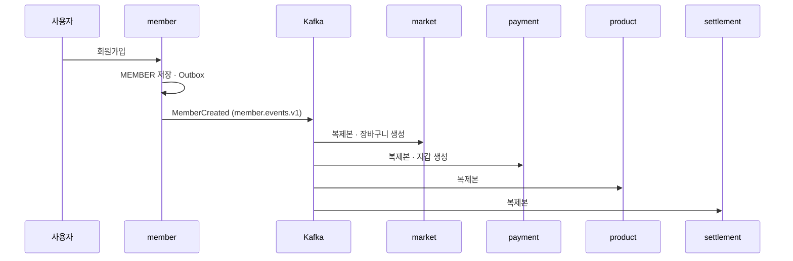

# 가입과 회원 복제본

> 언제 읽나: 가입 · 회원 정보 변경이 다른 서비스에 퍼지는 흐름을 볼 때
> 상태: ✅ 확정 · 마지막 수정 2026-11-08 · 관련: Miro 5 · 9

## 흐름

- 복제본은 닉네임 · 권한 · 판매자 여부입니다.
- **판매자 기본 배송지**는 `member.address.events.v1`로 market만 받습니다 (암호화).
- **계좌는 복제하지 않습니다.** payment가 인출할 때 member 내부 API로 조회합니다 → [ADR 0015](../decisions/0015-member-topics-two-account-api.md)

## 복제본이 아직 없을 때

가입 직후 이벤트보다 요청이 먼저 오면 복제본이 없을 수 있습니다. 이때 장바구니 · 지갑은 **JWT의 memberId로 get-or-create**합니다. 받는 쪽 리스너도 upsert라 나중에 온 이벤트와 충돌하지 않습니다 (S-B03).

## 탈퇴

| 단계 | 내용 |
|---|---|
| 막는 조건 | 구매 확정 전 주문(구매 · 판매, 결제 대기 · 판매자 수락 대기 포함), 예치금 잔액, 진행 중 충전 · 충전 취소 · 인출, 미지급 정산, 미수금 |
| 확인 | market · payment · settlement 내부 API 3개를 **병렬** 호출. 실패하면 막음 (Fail-closed), 사유를 팝업으로 |
| 잔액 | 회원이 탈퇴 전에 직접 정리 (토스 취소 기한 안은 충전 취소, 나머지는 계좌 인출). 정리를 시작하면 지갑이 잠김 |
| 소셜 회원 | 카카오 연결 해제 API를 먼저 호출, 실패하면 탈퇴 막음 |
| 처리 | 소프트 삭제 · 개인정보 익명화 · `auth:revoked-member` · Refresh 삭제 → `MemberWithdrawn` |
| 다른 서비스 | 복제본은 지우지 않고 탈퇴 상태로 ("탈퇴한 회원"). product는 판매 중 · 검수 중 · 반려 상품을 `DELETED` |
| 재가입 | 이메일 · 휴대폰 HMAC + 탈퇴 시각만 남겨 30일 동안 재가입 불가, 30일 뒤 삭제 |
| 한계 | 확인 후 저장까지 수 초 사이 본인이 직접 충전하면 잔액이 남을 수 있음 → 운영자가 처리 |

카카오 쪽에서 연결을 끊으면(연결 해제 웹훅) 탈퇴 조건을 확인해 통과하면 자동 탈퇴, 아니면 "소셜 연결 해제됨"으로 두고 이메일로 안내합니다.
