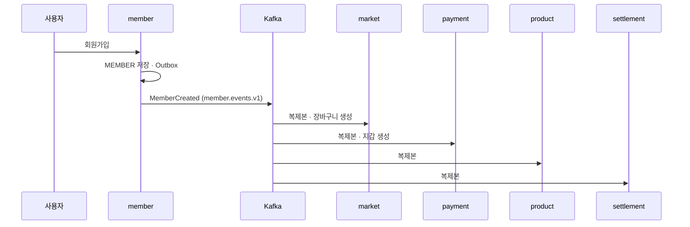

# 가입과 회원 복제본

> 언제 읽나: 가입 · 회원 정보 변경이 다른 서비스에 퍼지는 흐름을 볼 때
> 상태: ✅ 확정 · 마지막 수정 2026-11-19 · 관련: Miro 5 · 9

## 흐름

- 복제본은 닉네임 · 권한 · 판매자 여부입니다.
- **판매자 배송지 목록**은 `member.address.events.v1`로 market만 받습니다 (암호화). 판매자 등록 · 배송지 추가 · 기본 배송지 변경 때 바뀐 뒤 전체 목록을 보내고, 판매자는 주문 수락 때 이 중에서 보내는 주소를 고릅니다 → [payload](../reference/kafka-topics.md#payload)
- **계좌는 복제하지 않습니다.** payment가 인출할 때 member 내부 API로 조회합니다 → [ADR 0015](../decisions/0015-member-topics-two-account-api.md)

## 복제본이 아직 없을 때

가입 직후 이벤트보다 요청이 먼저 오면 복제본이 없을 수 있습니다. 이때 장바구니 · 지갑은 **JWT의 memberId로 get-or-create**합니다. 받는 쪽 리스너도 upsert라 나중에 온 이벤트와 충돌하지 않습니다 (S-B03).

## 탈퇴

결정 배경 → [ADR 0028](../decisions/0028-member-withdrawal-kakao-unlink-policy.md)

| 단계 | 내용 |
|---|---|
| 막는 조건 | 구매 확정 전 주문(구매 · 판매, 결제 대기 · 판매자 수락 대기 포함), 예치금 잔액, 진행 중 충전 · 충전 취소 · 인출, 미지급 정산, 미수금 |
| 확인 | market · payment · settlement 내부 API 3개를 **병렬** 호출 (`GET /internal/v1/{orders, payments, settlements}/members/{memberId}/withdrawalCheck`, 공통 응답 `hasWithdrawalBlocker` · `blockingReasons` · `details`). 결과는 `ALLOWED` · `BLOCKED` · `UNAVAILABLE`이고 **탈퇴는 `ALLOWED`일 때만** 진행. 호출 실패 · 응답 형식 오류(값 누락, 차단 여부와 사유 불일치)는 `UNAVAILABLE`(Fail-closed), 차단과 실패가 함께면 `UNAVAILABLE` |
| 잔액 | 회원이 탈퇴 전에 직접 정리 (토스 취소 기한 안은 충전 취소, 나머지는 계좌 인출). 정리를 시작하면 지갑이 잠김 |
| 다른 서비스 | 복제본은 지우지 않고 탈퇴 상태로 ("탈퇴한 회원"). product는 판매 중 · 검수 중 · 반려 상품을 `DELETED` |
| 한계 | 3곳 확인은 읽기 전용이라 확인과 member 커밋 사이(카카오 연결 해제 포함 수 초)의 다른 서비스 변경은 막지 못함: 본인이 충전하면 잔액이 남을 수 있음(운영자가 처리). 그 사이 다른 구매자가 이 판매자의 상품을 주문해도 판매자 수락 전(`ACCEPT_PENDING`)이라 배송이 생기지 않고, 24시간 무응답으로 자동 거절 · 환불됨(구매자는 그 전에 언제든 취소 가능) → [판매자 수락](../services/market.md#정책) |

### 직접 탈퇴

요청 · 응답 · 에러 코드는 [외부 API](../reference/external-apis.md#회원-탈퇴)에 있습니다.

| 단계 | 내용 |
|---|---|
| 사전 확인 | `GET users/me/withdrawal`로 확인 결과와 차단 사유를 보여 줌. **화면 안내용**이라 결과를 저장하지 않고, 최종 요청에서 다시 확인함 |
| 재확인 | 로컬 회원은 최종 요청 본문의 현재 비밀번호(틀린 횟수는 비밀번호 변경과 같은 키로 합산), 카카오 회원은 이메일 재인증으로 받은 일회용 탈퇴 토큰. 최종 탈퇴 POST 요청에서는 재확인을 3개 서비스의 탈퇴 가능 여부 확인보다 **먼저** 해서, 추가 본인 확인 없이 최종 탈퇴나 카카오 연결 해제가 진행되지 않게 함. 사전 확인(GET)은 로그인만 요구하는 화면 안내용으로 따로 둠. 로컬 · 카카오 모두 재확인 때 인증 버전을 읽어 두고 최종 잠금 안에서 다시 비교 |
| 비밀번호 확인 | 짧은 회원 잠금 안에서 확인하고, 틀리면 잠금을 풀기 전에 기록. 이때 인증 버전을 읽어 둠. 외부 호출 동안에는 잠금을 잡지 않음. 비밀번호가 맞아도 탈퇴가 완료되지 않으면 공유 실패 횟수를 초기화하지 않음 |
| 탈퇴 토큰 확인 | 카카오 회원. 토큰을 소비하지 않고 확인 → 회원 상태와 인증 버전 확인. 토큰은 「카카오 연결 해제」 직전에만 꺼냄 |
| 확인 | 위 「확인」. `ALLOWED`만 진행 |
| 카카오 연결 해제 | 카카오 회원만. 탈퇴 토큰을 꺼낸(`GETDEL`) **뒤** 어드민 키 + 회원번호(`provider_id`)로 호출하고, 실패하면 탈퇴를 막음. 이미 해제된 회원의 응답(HTTP 400 + `-101 NotRegisteredUserException`)은 성공으로 처리. 다른 상태의 `-101`은 실패 |
| 처리 | 토큰 폐기(`WITHDRAWN`)의 회원 잠금 · 트랜잭션 안에서 `ACTIVE`인지, 인증 버전이 재확인 때와 같은지 다시 확인 → 익명화 · 탈퇴 기록 저장 · `MemberWithdrawn` Outbox 저장을 한 트랜잭션으로 |
| 카카오 해제 후 DB 실패 | 회원은 `ACTIVE`로 남고 탈퇴 토큰은 이미 소모돼 이메일 재인증 후 다시 탈퇴. 연결이 끊긴 상태로 재시도하면 카카오 해제의 HTTP 400 + `-101`을 성공으로 처리. 카카오 재로그인으로 연결이 복구된 경우(같은 회원번호 유지는 11/18 로컬 확인) 다음 탈퇴에서 연결을 다시 해제. 실패 직후 자동 복구는 하지 않음 |

### 익명화

| 대상 | 처리 |
|---|---|
| 회원 개인정보 | `email` · `password` · `phone` · `nickname` · `provider_id` · 계좌(`bank_code` · `account_no_enc` · `account_holder` · `account_updated_at` · `account_hash`) → NULL. `provider`는 유지, 상태 `DELETED` |
| 배송지 | 모두 삭제 (주문은 주소를 스냅샷으로 가지고, market의 판매자 주소 복제본은 탈퇴 이벤트로 지워짐) |
| 판매자 | 행은 유지하고 소개글만 NULL. 동의 버전 · 시각은 남김 |

### 재가입 제한

| 항목 | 내용 |
|---|---|
| 탈퇴 기록 | 이메일(가입과 같은 정규화) · 휴대폰의 HMAC(`MEMBER_HMAC_KEY`, `email:` · `phone:` 접두사)과 탈퇴 시각. `member_id`는 넣지 않음. 원문은 복원할 수 없지만 키를 가진 쪽은 같은 값인지 대조할 수 있음 |
| 판정 | 로컬 · 소셜 가입 트랜잭션에서 회원 INSERT 후 커밋 전에 탈퇴 기록을 조회한다. 탈퇴 시각이 DB 현재 시각 기준 **30일 이내**이고 이메일 · 휴대폰 중 하나라도 같으면 409 `REJOIN_RESTRICTED`로 가입 전체를 롤백한다. 어느 쪽이 일치했는지는 응답에서 구분하지 않음. 탈퇴의 익명화와 탈퇴 기록이 한 트랜잭션으로 커밋되므로, 탈퇴 커밋 전에는 기존 이메일 · 휴대폰 중복 검사에, 커밋 후에는 이 조회에 걸림(S-B08) |
| 앞 단계 | 가입 인증번호 발송 · 휴대폰 중복 확인에서는 탈퇴 이력을 보지 않음 (탈퇴 여부 노출 방지) |
| 정리 | 30일 지난 기록은 스케줄러가 삭제. 판정은 스케줄러 지연과 무관 |

⬜ 미정: 탈퇴 기록 30일 보관의 개인정보 처리 근거 · 고지 방식, 판매자 동의 기록 보존 의무 → [미정 항목](../open-questions.md)

### 카카오 연결 해제 웹훅

| 단계 | 내용 |
|---|---|
| 수신 | `/api/v1/webhooks/kakao/unlink`. `Authorization: KakaoAK {어드민 키}`가 틀리면 401로 끝냄. 인증에 성공하면 수신 기록을 저장한 뒤 **3초 안에 200** (카카오 요구사항). 회원 처리는 여기서 하지 않음. 웹훅에는 고유 ID · 발생 시각이 없어 같은 값이 다시 와도 재전송인지 새 연결 해제인지 구분할 수 없으므로, 회원 상태 변경 · 토큰 폐기 · 자동 탈퇴가 중복 반영되지 않게 멱등 처리. 우리가 API로 연결을 끊은 경우 카카오는 웹훅을 보내지 않음 |
| 비동기 처리 | 어드민 키로 카카오에 현재 연결 상태를 조회. 연결됨(200)이면 재연결 · 늦은 웹훅으로 보고 기록을 무효 처리. 끊김(`-101`)이면 토큰 폐기(`SOCIAL_UNLINKED`)의 잠금 · 트랜잭션 안에서 기록이 아직 미처리인지 다시 확인한 뒤 `INACTIVE` |
| 재로그인 | 카카오 재연결이 허용된 `INACTIVE` 회원은 회원 잠금 안에서 이전 수신 기록을 무효로 하고 `ACTIVE`로 복구한 뒤 토큰 발급. `UNLINK_FROM_ADMIN`으로 `INACTIVE`가 된 회원의 자동 복구 여부는 미정 |
| 돈 처리 | `INACTIVE` 동안에도 정산 · 환급용 내부 계좌 조회는 응답 |
| 한계 | 카카오 조회와 DB 잠금은 하나로 묶을 수 없고 웹훅에 발생 시각이 없어, 연결 해제 · 재연결 순서를 완벽히 판별하지는 못함. 이 설계는 경쟁을 줄이는 방어임 |

| `referrer_type` | 뜻 | 처리 |
|---|---|---|
| `ACCOUNT_DELETE` | 카카오계정 탈퇴 | 자동 탈퇴 대상 |
| `FORCED_ACCOUNT_DELETE` | 장기 휴면 · 고객센터 강제 탈퇴 | 자동 탈퇴 대상 |
| `UNLINK_FROM_APPS` | 사용자가 카카오계정 페이지에서 직접 해제 | 자동 탈퇴 대상 |
| `UNLINK_FROM_ADMIN` | 카카오 관리자 처리 | `INACTIVE`만 (사용자 의사를 알 수 없어 탈퇴 · 재가입 제한을 걸지 않음) |
| `INCOMPLETE_SIGN_UP` · 회원 없음 · 알 수 없는 값 | 가입 미완료 등 | 처리 없음 (수신 기록만) |

자동 탈퇴 대상은 재확인 · 카카오 해제 없이 「확인」을 거쳐 `ALLOWED`면 직접 탈퇴와 같은 처리(익명화 · 탈퇴 기록 · 이벤트)를 합니다. 이 경로에서만 `INACTIVE` 회원의 탈퇴를 허용합니다. 최종 탈퇴 트랜잭션에서는 회원 잠금 안에서 상태가 여전히 `INACTIVE`인지, 해당 수신 기록이 아직 유효한지 다시 확인하고, 재연결로 `ACTIVE`가 됐거나 기록이 무효가 됐으면 탈퇴하지 않습니다. `BLOCKED`면 `INACTIVE`로 두고 가입 이메일로 안내합니다.

🟨 제안: `UNAVAILABLE`이면 `INACTIVE` + 안내 후 횟수 · 간격을 제한해 자동 재확인하고, 끝내 확인하지 못하면 운영자가 확인

⬜ 미정: 수신 기록 테이블(이름 · 중복 수신 판정 기준 · 처리 상태 · 재시도 시각 · 횟수), 수신 기록 저장 실패 시 응답, `UNLINK_FROM_ADMIN` 회원의 재로그인 복구, 강제 탈퇴 회원의 잔액 처리 → [미정 항목](../open-questions.md)
